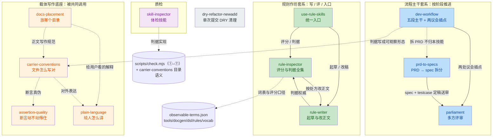

# 技能清单：各自的作用与使用时机

> 这是 README「技能与规则」的展开指南，README 只保留速查表以控制篇幅。**下文路径相对仓库根 `d:\Seed\retro-skills`**（除非另注）。
> 已退役的技能连同其依赖清单一起归档在 `bak_skill/`，不在 `skills/` 注册。

## 技能结构图：套系、依赖与共同底座

> 本图解释本仓 `skills/` 的套系归属与调用关系；技能清单与数量以 `skilldependencies/manifest.json` 为准。
> 本图只作说明，不是判据来源；关系以各 `SKILL.md` 正文为准。

### 全景

实线 = 硬依赖或流程调用；虚线 = 规范引用或划界指向。

### 套系分组

| 套系 | 成员 | 共同点 | 入口 / 主流程 |
|---|---|---|---|
| 流程主干 | `dev-workflow`、`parliament`、`prd-to-specs` | 管「现在该做哪一步、这一步过没过」；议会只在指定插点出现 | `dev-workflow` 的五段主干；`prd-to-specs` 在其前做拆分 |
| 规则作坊 | `use-rule-skills`、`rule-writer`、`rule-inspector` | 围绕 rule 的「入口 → 起草 → 评分 → 验收」闭环 | `use-rule-skills`（唯一入口） |
| 载体写作底座 | `carrier-conventions`、`assertion-quality`、`plain-language`、`docs-placement` | 管文件/文字的「写对、说真、讲人话、放对位置」 | 无统一入口，按任务被其他技能引用 |
| 质检 | `skill-inspector` | 技能体检；不自动触发 | 独立触发 |
| 独立工具 | `dry-refactor-newadd` | 只审最近一次提交新增的重复代码，不进入上述套系 | 用户显式触发 |

### 依赖关系（源 → 目标）

| 源 | 目标 | 关系 | 证据 |
|---|---|---|---|
| `use-rule-skills` | `rule-inspector` | 硬依赖：评分/判据 | `skills/use-rule-skills/SKILL.md:3`、`:56` |
| `use-rule-skills` | `rule-writer` | 硬依赖：起草/写作指引 | `skills/use-rule-skills/SKILL.md:57` |
| `rule-writer` | `rule-inspector` | 判据权威 + 检查项同步义务 | `skills/rule-writer/SKILL.md:16`、`:35` |
| `rule-writer` | `use-rule-skills` | 草稿箱与验收回路 | `skills/rule-writer/SKILL.md:31`、`:43` |
| `rule-inspector` | `rule-writer` | 划界：改正文归 writer | `skills/rule-inspector/SKILL.md:3` |
| `dev-workflow` | `parliament` | 流程调用：①、② 两处议会插点 | `skills/dev-workflow/SKILL.md:29-32` |
| `parliament` | `dev-workflow` | 收敛/升级规则互指 | `skills/parliament/SKILL.md:9`、`:20` |
| `prd-to-specs` | `parliament` | spec 定稿后送审 | `skills/prd-to-specs/SKILL.md:57` |
| `dev-workflow` | `prd-to-specs` | 划界：拆 PRD 归 prd-to-specs | `skills/dev-workflow/SKILL.md:3` |
| `dev-workflow` | `carrier-conventions` | 引用：判据写成可观察形态 | `skills/dev-workflow/SKILL.md:77` |
| `docs-placement` | `carrier-conventions` | 引用：技能资产目录的骨架判据 | `skills/docs-placement/SKILL.md:76` |
| `docs-placement` | `plain-language`、`carrier-conventions` | 划界：正文写法不归本技能 | `skills/docs-placement/SKILL.md:3` |
| `docs-placement` | `dev-workflow` | 引用：after 回扫判据 | `skills/docs-placement/SKILL.md:72` |
| `carrier-conventions` | `assertion-quality`、`plain-language` | 边界互斥表 | `skills/carrier-conventions/SKILL.md:8`、`:14-16` |
| `assertion-quality` | `carrier-conventions`、`plain-language` | 划界：格式/表达不归本技能 | `skills/assertion-quality/SKILL.md:3` |
| `plain-language` | `carrier-conventions`、`assertion-quality` | 划界：文件写法/断言真伪不归本技能 | `skills/plain-language/SKILL.md:3` |
| `skill-inspector` | 本技能 `scripts/check.mjs`（①–⑦）、`carrier-conventions` | 判据实现与目录语义 | `skills/skill-inspector/SKILL.md:14`、`:20` |

### 被共同调用的底座

| 底座 | 被谁引用 | 具体用法 | 证据 |
|---|---|---|---|
| `carrier-conventions` | `dev-workflow`、`docs-placement`、`assertion-quality`、`plain-language` | 判据可观察形态、技能目录骨架、文件写法边界 | `skills/dev-workflow/SKILL.md:77`、`skills/docs-placement/SKILL.md:76` |
| `assertion-quality` | `carrier-conventions`、`plain-language` | 断言真伪与可复核性 | `skills/carrier-conventions/SKILL.md:14` |
| `plain-language` | `carrier-conventions`、`docs-placement` | 给用户看的解释怎么讲 | `skills/carrier-conventions/SKILL.md:16`、`skills/docs-placement/SKILL.md:3` |
| `rule-inspector` 判据 | `use-rule-skills`、`rule-writer`、`parliament` | 规则评分、写作归一口径、rule 类送审的评分证据 | `skills/use-rule-skills/SKILL.md:56`、`skills/rule-writer/SKILL.md:35`、`skills/parliament/references/submission-matrix.md:14` |
| `dev-workflow` | `parliament`、`docs-placement` | 评审轮/升级口径、after 回扫 | `skills/parliament/SKILL.md:9`、`skills/docs-placement/SKILL.md:72` |

### 非技能依赖（读图时别误当技能）

| 依赖 | 类型 | 用途 | 位置 |
|---|---|---|---|
| `agents/*.md` 角色卡 | 生成物 | 议会角色、`senior-sdet` 写 testcase、`evidence-reader` 取证 | 由 `tools/docgen` 生成；见 `skills/parliament/SKILL.md:15`、`skills/prd-to-specs/SKILL.md:51` |
| `scripts/*.mjs`（技能内） | 脚本 | `use-rule-skills` 草稿箱、`rule-inspector` 评分、`skill-inspector` 检查 | 各技能 `scripts/` 目录 |
| `tools/docgen/**` | 工具链 | 角色卡生成、gate、baseline | 见 `skills/parliament/SKILL.md` 与 `dev-workflow` 的验证命令 |
| 平台沟通 / 执行模式 | 仓外全局机制 | 副作用动作前的确认纪律 | 由平台会话模式控制；本仓 `rules/` 不装该类规则 |
| `systematic-debugging` | 外部技能/流程 | 缺陷定位 | 在 SKILL.md 中以「走 X」形式划界 |

### 维护本图

1. 新增/删除 `skills/<名>/` 时，同步改「套系分组」与「依赖关系」两表。
2. 新增跨技能引用时只写技能名、不写对方内部路径；口径见 `skills/carrier-conventions/references/skill-structure.md`。
3. 本图是说明性内容，不承担判据；关系断链时以各 `SKILL.md` 正文为准，并回头修本图。

### 1. `parliament` — 议会（多方评审）

- **什么时候用**：用户说「开议会」「议会评审」「评审团」「三方评审」，或要评审 PRD / spec / plan / rule / skill / agents / 描述性或记录型文档，找逻辑漏洞、矛盾、盲点（套件自己的架构文档与 spec 也用它评审）。
- **做什么**：议会评审：按项目类型 × 文档类型点将组队，评审团双清单提问、答辩方作答、侦探观察、审计闸门，3 轮答辩未决升级用户。评审中发现的盲区教训回流 KB（`<KB>/skills/parliament/ledger.md`）。
- **不做什么**：代码审查、写新文档（那是别的工具的事）。

### 2. `prd-to-specs` — PRD 拆分（PRD → Specs）

- **什么时候用**：已有定稿 PRD，要拆成可独立开发、可独立验收的 spec 与路线图（用户说「拆分PRD」「生成spec拆分方案」「规划spec路线图」）。
- **做什么**：提取四件套（验收锚点 / 硬约束 / 非目标 / 待定决策）→ 六规则切分（垂直切片、依赖 DAG、变更半径不重叠、风险前置、规模上限、验收锚定）→ **JIT 门**（路线图只写骨架，字段级设计推迟到 spec 开工）→ **双份真相禁令**（PRD 已定内容只引用不抄写）。
- **不做什么**：写实现计划、写代码、代码评审；不为路线图建任何新文件（README 索引、shared 文档默认都不建）。拆出的 spec 建议走 `parliament` 评审。

### 3. `dry-refactor-newadd` — 最近一次提交的冗余代码清理

- **什么时候用**：刚提交完一批改动，想清理掉**这次提交**新引入的"复制粘贴"重复，并看到一份改前改后对比的审计报告。**前提：工作区必须干净**（未提交的改动要先由你提交——提交既是对比基准的前提，也是出问题的回退点）。
- **做什么**：按提交数选模式——≥2 个提交时用 jscpd v5（本机已装 5.3.x）的 `--baseline-from-ref HEAD~1`，只报**本次提交新增**的重复（旧债不碰）；只有 1 个提交则全量扫描（无"改动前"可比）。然后按五种策略（抽函数 / 参数化 / 抽模块或常量 / 基类 / 模板）抽取合并 → 复测 + 跑项目自身测试 → 输出三块审计报告（改了什么 / 跳过了什么及原因 / 重复行数 X→Y 及占比，数字附取数命令）。
- **不做什么**：不做死代码检测（jscpd 的 `--dead-code` 是另一条线，本技能范围不含）；不清理基准里已有的历史重复；技能自身不做 git 写操作。

### 4. `rule-inspector` — 判据驱动的规则检察员

- **什么时候用**：用户说「体检 rules / 优化 rules」。
- **做什么**：按判据全集给 `rules/` 里的规则评分、出报告、给处方、防劣化（体检/评分走它）。
- **不做什么**：新建规则（走 use-rule-skills）、按处方改规则正文（走 rule-writer）、审查（走专门的审查流程）。

### 5. `rule-writer` — 写新规则 / 按处方优化已有规则

- **什么时候用**：用户说「写一条规则 / 优化这条规则」。
- **做什么**：按判据四要素 + 执行力度 9 项 + 来源行 + 分层级 + 判定词归一，写新规则或按 inspector 处方优化已有规则（写规则的，自然也改规则）。
- **不做什么**：体检/评分/处方（走 rule-inspector）、审查（走专门的审查流程）。

### 6. `skill-inspector` — 判据驱动的技能检察员

- **什么时候用**：用户说「体检 skills / 优化 skill / 检查技能」。
- **做什么**：按本技能 `scripts/check.mjs`（①–⑦）判据给 `skills/` 里的技能评分、出报告、给处方、修复优化。
- **不做什么**：新建规则（走 use-rule-skills）。

### 7. `use-rule-skills` — 新建/优化规则的统一入口

- **什么时候用**：触发「新建 rule / 优化这个 rule / 裸调用」。
- **做什么**：判定意图 → 路由 rule-writer 起草 / rule-inspector 评分 → 草稿箱管理 → 报告（依赖 rule-inspector + rule-writer）。
- **不做什么**：不自动触发；自身不写规则正文（那是 rule-writer）。

### 8. `dev-workflow` — 开发工作流主干（五段 + 两插点）

- **什么时候用**：任务要走「需求 → 技术设计 → 计划门 → 实现 → 质量 → 交付」这条主干，或需要判断现在该进哪一段、本段出口齐没齐；也用于需要长文取证（只交原文 + 行号）的场合。
- **做什么**：给出段表（每段的出口判据 / 谁签 / 是否有议会）、两个议会插点、三权总则与取证调度；每段开工前产出「已核清单」写进任务目录 `docs/devworkflows/<YYYYMMDDHHmmss>-<任务名>/gate-record.md`，缺清单不得进入下一段。强制约束见本技能 SKILL.md 的「义务边界」与 `references/gate-record-template.md` 的 R1–R9。
- **不做什么**：不做单点代码修改与缺陷定位（走 `systematic-debugging` 等专用技能）；不做议会内部流程（走 `parliament`）；不拆 PRD（走 `prd-to-specs`）。

### 9. `carrier-conventions` — 载体写作规范

- **什么时候用**：写 / 改 rule、skill、agent、references 的正文，或判断一段内容该进 rule、skill、references、脚本还是 git 历史；也用于把判据写成可观察形态、把「读 reference」接上产出闭环、摊技能目录骨架。
- **做什么**：四类该进 rule / 四类不该进、判别法两条、正文四层；判据可观察形态的六要素与豁免清单；reference 闭环写法；技能三档骨架与引用纪律；全局规则单一来源。
- **不做什么**：体检评分（走 `skill-inspector` / `rule-inspector`）、起草新规则（走 `rule-writer`）、断言真伪校验（走 `assertion-quality`）、给用户怎么讲（走 `plain-language`）。

### 10. `assertion-quality` — 断言质检（三轴手册）

- **什么时候用**：写下或复核会影响别人决策的断言（判断 / 结论 / 数据 / 方案），或要验别人的话站不站得住；签字、送审、对外交付前的材料自查。
- **做什么**：三轴（真实 / 合理 / 有效）定义与正交关系；材料 schema 六字段；四步证伪式审查程序；证书模式成本分层；判心 residual 四件登记与三闸门；出处锚强度分级与时序纪律。
- **不做什么**：改文件格式（走 `carrier-conventions`）、给用户怎么讲（走 `plain-language`）。

### 11. `plain-language` — 面向人的表达

- **什么时候用**：向用户输出解释、结论、方案、报告；用户说「说人话」「讲明白点」；自查一段给用户看的文字是不是只有自己看得懂。
- **做什么**：四条义务（不用行话内部编号 / 不省机理 / 落到具体例子 / 一句话一件事）+ 冲突裁决（简的是句子不是机理）+ 写完自查。
- **不做什么**：文件内部写法（走 `carrier-conventions`）、断言真伪校验（走 `assertion-quality`）。

### 12. `docs-placement` — 项目文档目录与命名

- **什么时候用**：新建 / 移动 / 命名 `docs/` 下的文档，或判断内容该进 `docs/prd`、`specs`、`plans`、`handoffs`、`after`、`research`、`devworkflows`、`.session`；也用于判断待办何时该搬走 / 删除。
- **做什么**：按生命周期状态分目录；目录表与命名规则；`.session/` 封闭清单与硬边界；待决只在 `docs/after/`；待办语义（不许 ✅ 档）；与 `dev-workflow` 的 after 回扫判据反向对齐。
- **不做什么**：写文档内容本身（走 `plain-language` / `carrier-conventions`）；rule 正文（走 `carrier-conventions`）；技能资产目录（走 `carrier-conventions`）。
