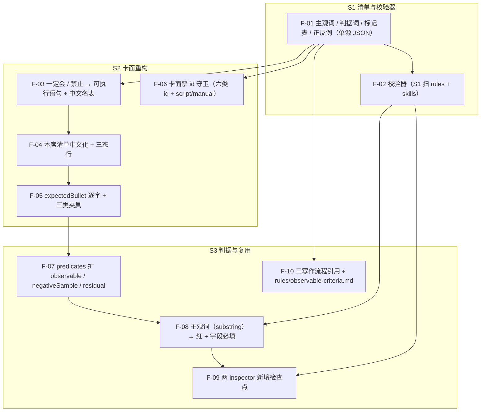

# 可观察判据与卡面表达重构（PRD）

> **状态**：**已定稿（2026-10-31）**——议会 #1 通过（5 席 / 60 卡 / 19 族，P0 = 0；审计两表终验「通过」）+ 用户签字（原话「通过，签字」）｜**创建** 2026-10-31 20:23（Asia/Shanghai）｜**2026-10-31 更新**：用户确认 ① 走议会 #1、补主干图、D-01～D-06 按建议（A-5～A-7）；议会后按 19 族返工（见 `.session/reviews/2026-10-31-204101-observable-criteria-prd/`）
> **来源**：2026-10-31 与用户的对话——起点是「agent 卡面里全是 id，AI 读得懂吗」，收敛到「用户写 agent / rule / skill 时用的抽象、主观、模糊的话，必须被翻译成具体、客观、精确、可执行的判据，并让三个载体复用同一套规则」。
> **与本 PRD 的关系**：`agent-card-contract`（2026-10-26）定义了卡面的**结构**；本 PRD 解决它的**表达与可判定性**，并把同一口径外延到 `rules/` 与 `skills/`。

---

## 0 裁决记录与事实基线

### 0.0 硬门状态与授权边界

| 栏位 | 状态 | 说明 |
|---|---|---|
| 精算师 | **留空** | 本 PRD 不引入新成本口径；§0.3 的数字均带取数命令，可复查 |
| 市场 | **留空** | 仓库无市场 / 调研角色（`dev-workflow-mainline` F-01 属其 S2，未开工） |
| 产品经理 | **留空** | 仓库无产品经理席（mainline F-03 未开工）；本 PRD 由主 agent 代拟，**① 段签字人 = 用户** |
| 用户 | **已参与并签字（2026-10-31）** | 裁定见 §0.2 的 A-1～A-7；① 段出口签字见 `skills/dev-workflow/references/gate-record.md` 的 `①@observable-criteria-rollout` 行 |

**授权边界**（本 PRD 定稿前）：

| 层 | 允许 | 判据 |
|---|---|---|
| 改文档 | 本 PRD 可按评审结论修订 | 段① 出口未签 → 不得进 spec 编写 |
| 改代码 / 改规则 | **禁止** | §8 状态列全为「未开始」 |

### 0.1 三档标记

| 标记 | 含义 | 本文义务 |
|---|---|---|
| `[已确认]` | 用户当场说过 | 每处能在 §0.2 指到 A-x；改口径须回本节重签 |
| `[已决·代裁]` | AI 下结论 | 每处能在 §0.6 指到 C-x；用户可逐条推翻 |
| `[待确认]` | 只有倾向 | 定稿前必须收敛为前两档 |

### 0.2 已确认（用户裁定，2026-10-31）

| # | 裁定 | 用户原话（摘要） |
|---|---|---|
| A-1 | **卡面不放 id**。id 只留在数据层、`dump`、README 覆盖记录表；卡面写中文语义 | 「id 是用来在 script 那里判断是否正确的，和放在 agent 里面有什么关系？……你把展示和 id 都放到 markdown 里面这个不对」 |
| A-2 | 卡面要**组合成能执行的语句**，不要"字段名 + 值"的机器人式表格 | 「难道不能把他们组合成一条或者一段有格式的句子……像一个不会说话的机器人」 |
| A-3 | 这套"抽象 → 具体"的翻译**不只给 agent 用**，`rule` 与 `skill` 编写同样适用 | 「后面 rule 和 skill 编写一样用得到……可以让这套复用」 |
| A-4 | 先记成 PRD，再按 spec → testcase → plan 推进 | 「把我们的今天说的记录成 PRD，然后我们开始换成成 spec，testcase，和 plan 的方式继续」 |
| A-5 | **① 段走议会 #1，不跳过** | 「走议会 #1（推荐）」（2026-10-31，AskUserQuestion） |
| A-6 | **① 出口补主干流程图**（F-01～F-10 节点）+ §6 加「进流程图」列 | 「补一张主干图（推荐）」（2026-10-31，AskUserQuestion） |
| A-7 | **D-01～D-06 全部按本 PRD 建议**：A 短指令句 / 删「前提：无」/ 三态行在「一定会」段末 / 词表扩到 ~10 词 / 行级白名单 / F-08 扩 `SubjectiveLabel` 判定面 | 「A 短指令句」「删」「「一定会」段末」「扩到 ~10 词」「行级白名单」「扩面（需 ② 确认）」（2026-10-31，AskUserQuestion） |

### 0.3 事实基线（全部可复算，cwd = 仓根）

| # | 事实 | 取数命令 | 结果 |
|---|---|---|---|
| 1 | 15 席卡的 `must` / `never` / `checkItems` 规模 | `node --input-type=module -e "const CP=await import('./tools/docgen/components/cardPipeline.mjs');const b=CP.buildCards();console.log(JSON.stringify({seats:b.length,must:b.reduce((n,x)=>n+x.card.must.length,0),never:b.reduce((n,x)=>n+x.card.never.length,0),items:b.reduce((n,x)=>n+x.card.checkItems.length,0)}))"` | `{"seats":15,"must":75,"never":60,"items":97}` |
| 2 | 检查项类型分布 | 同上脚本取 `checkItems[].check` 去重计数 | `manual` 94 / `script` 3（**卡面直接渲染英文枚举**） |
| 3 | 判据登记表 8 条里含主观词的数量 | 对照 `tools/docgen/card-model/vocab/subjective-terms.mjs` 的 5 词表扫 `predicates.mjs` 的 `label` | **1 条**：`impartial-long-term` = 「立场**客观**且按项目长远判断」 |
| 4 | 8 条判据里"无法二值判"的数量 | 人工判（`plain-expression` = 「用非专业人员也能**听懂**的方式表达」） | **1 条**（无主观词，但无可观察判据） |
| 5 | `rules/` + `skills/` 的文档面 | `(Get-ChildItem rules,skills -Recurse -Filter *.md).Count` | 两树共 **106** 个 `.md`（rules 22 条 / skills 19 个目录） |
| 6 | 两树里命中主观词的行数 | `(Get-ChildItem rules,skills -Recurse -Filter *.md) \| Select-String -Pattern '自省\|客观\|诚实\|宽松\|严格' \| Measure-Object -Line` | **23 行去重 / 25 次词命中**（自省 8 / 客观 7 / 诚实 6 / 宽松 3 / 严格 1；`skills/parliament/assets/agent-template.md:13` 一行含 3 词；逐词计数把 `-Pattern` 拆成单字各跑一次）→ 多数是**合法用法**（如规则名「自省」），必须有豁免机制 |
| 6b | D-04 定稿 10 词后的命中面 | 同上命令，`-Pattern` 换成定稿 10 词（`自省\|客观\|诚实\|宽松\|严格\|清晰\|完整\|准确\|显著\|良好`） | **77 行 / 81 次**（自省 8 / 客观 7 / 诚实 6 / 宽松 3 / 严格 1 / 完整 56；清晰·准确·显著·良好 本次 0 命中，仍保留 = 词表按语言面定，但同样必须有正反例）→ 豁免基线从 23 行升到 77 行 |
| 7 | 卡面里出现英文 id / 枚举的段 | 逐段抽 ASCII token | 「一定会」「禁止」「本席清单」三段；**实测校正**：`producer` 在 2 张卡的「边界」段（`agents/reviewer-audit.md:85`、`agents/detective-observer.md:67`）；`S5-B` 在卡面 **0 命中**；死路径串实为 `tools/docgen-spike/.tmp-test/`（目录 `Test-Path` = **False**），在 2 张卡的禁写清单里 |
| 8 | 现有机械判据依赖"卡面含 id / 英文字段名"的处数 | `Select-String -Path tools\docgen\test\card-render.test.mjs -Pattern 'includes\(a\.(criterion\|landing)'` + 见下清单 | **≥8 处**：`:488-489`+`:498`（必渲染英文字段名）、`:895`（共享句子串）、`:1182`（卡面 `criterion: <id>` 残留）、`:1222`、`:1223`、`:1231`、`:1241-1257`（`pbMissing` 逐列 + 按 id 定位行）、`:1270`（构造改 `landing: ` 前缀）；另 `pilot-render.test.mjs:72`（卡面含共享 must id） |
| 9 | `docs/agents/` 生成物 | `Get-ChildItem docs/agents -Filter *.md` | **16** 份（15 席 + index） |

### 0.6 本轮代裁记录（用户可逐条推翻）

| # | 代裁 | 依据 | 被推翻时的后果 |
|---|---|---|---|
| C-1 | 复用的载体形态 = **规则（每轮加载）+ 判据清单（单源）+ 校验器（机器判）**；**不新建 agent 席位** | 翻译是"加工"不是"评审"；席位卡的价值是独立立场与签字；15 席再膨胀会漂 | 若推翻 → 新建席位，需同批定义其权限 / 边界 / 与既有席位的职责切分 |
| C-2 | **skill 先不建**；同一流程被复用 ≥2 次后再抽（可抽时形态 = 独立 skill，判据仍不在 skill 内） | 仓库"不提前抽象 / 攒批再抽"的既有教训 | 若推翻 → 本 PRD 增加 S4（抽 skill） |
| C-3 | S6 边界料三处（`producer` 档 / `S5-B` / 死路径）**不在本 PRD**，另批处理 | 三处均被 S6 已签判据钉死（`tool-tiers.test.mjs:264` 断「`producer` 档」；`paths.mjs:18` 计入 23 条路径计数） | 若推翻 → 本 PRD 增加 S5，并同批改 S6 spec 与计数基线 |
| C-4 | 卡面 id 的机械锚点改**行序号对账**（第 i 行 ↔ 第 i 条数据），并用「宾语≠落点」的合成卡保证落点被渲染 | 行序号比 id 更硬（行数都必须相等）；合成卡防"两个字段同值导致假阴性" | 若推翻 → 需另找行的身份键（会重新把 id 印回卡面） |
| C-5 | **标记表 / 判定窗口 / 卡面句式口径由 AI 起草**（议会第 1 轮后定稿）；任何增删须同批改本节与 §3.3 / §3.4 | 这三处是「怎么判」的判据面，用户未逐条裁定；给三档标记的「已决·代裁」可追位 | 若推翻 → 每处回到 `[待确认]`，① 段出口不可签 |
| C-6 | **扫描面分期**：S1 = `rules/` + `skills/`；S3 才扩到 `predicates[].label` 与卡面 | 卡面文案由 `predicates.label` 渲染，label 待到 S3 才改写 → 若 S1 就扫卡面，S1 落地即红、S2 出口不可达 | 若推翻 → S1 必须同批改 8 条已签 label（R8 回扫面翻倍） |
| C-7 | **与已签 S4 渲染 spec 的处置 = 给 spec 加「现行判据块 + 日期注」，原文一字不改** | `docs-convention` 对已签 spec 只许日期注与现行判据指针；本 PRD 改卡面形态必然与 spec §5.1 冲突 | 若推翻 → 须重开 S4 spec 评审，本 PRD 退回 ① |

---

## 1 要解决什么

三处病，同源：

| # | 病 | 具体表现 | 后果 |
|---|---|---|---|
| P-1 | **卡面是机器语言** | 「一定会」75 行、每行 5 个字段名 + 5 类 id（动作 / 场景 / 时刻 / 宾语 / 判据 / 落点） | AI 只能靠命名猜语义；人读也费劲（用户裁定 A-1） |
| P-2 | **判据是形容词** | 8 条判据里 1 条含「客观」、1 条要「听懂」 | 同一材料两个实例可能判不同；无法复核"做完没有" |
| P-3 | **三个载体没有统一翻译口径** | `rules/` + `skills/` 两树 23 行命中主观词；主观词表只用于卡面校验，没有覆盖规则与技能 | 用户写规则/技能时的模糊话，无人翻译、无人拦 |

**根因（一句话）**：仓库把"给机器看的键"和"给人/AI 看的语义"混在同一层，同时缺少把"形容词"压成"可观察条件"的统一动作。

---

## 2 范围

**做**

1. **可观察判据清单**（单源数据）：主观词表 + 判据词表划界 + 可观察标记表 + 每词一对正反例。
2. **校验器**（**分期上线，C-6**）：S1 扫 `rules/` / `skills/`；S3 扩到 `predicates[].label` 与卡面。命中主观词且最小语义块内无可观察标记 → 列 `path:line` 并 exit 1；接入 `npm run check`。
3. **卡面表达重构**：`一定会` / `禁止` 改为"数据组合成的可执行语句"（中文语义、无 id、无英文键）；`本席清单` 类型中文化；补三态行（中文解释一行 + `hit`/`miss`/`na`/`reason` 常量行）。
4. **行序号对账**：替代"卡面含 id / 英文字段名"的 ≥8 处锚点（§0.3-8）；保留 `gate` 逐字节兜底，且 baseline 重记由审计抽核。
5. **判据可观察化**：`predicates` 由 `{label, impl}` 扩为 `{label, impl, observable[], negativeSample, residual{who,sample}}`，**label 必须改写成可观察表述**（`observable` 只记残余量度，不豁免 label）。
6. **复用接线**：`rule-inspector` / `skill-inspector` **新增**检查点（四处落点，不删既有）；`rule-writer` / `skill-creator` / `dev-workflow` 引用同一规则（不复制判据）。

**不做**

- **不新建 agent 席位**（C-1）。
- **不提前抽 skill**（C-2；复用 ≥2 次后再抽）。
- **不改 S6 边界物料**（C-3：档位枚举 `producer` / 内部编号 / 死路径串）；**F-06 守卫词表不含档位枚举**（见 §3.4）。
- **不降低判据强度**：只加判据、不删；"删 id 锚点"必须以 `expectedBullet` 逐字 + 三类常驻夹具 + 数据层构造证明判别力不降。
- **不重写各席个性化文案**（沿用 `agent-card-contract` §2 的口径：只统一形态）。
- **不碰语义判定类判据**（"这条引用是否支撑结论"）——明确落 `residual: {who, sample}`（PRD `agent-card-contract:159` 既有口径）。
- **不把扫描面扩到** `docs/prd/` / `docs/superpowers/**` / README `rationale`；**不做自动改写**（校验器只报位置）。

### 2.1 与既有签字件 / 判据的处置（R8 回扫清单，逐条给动作）

| 既有件 | 冲突点 | 处置（改 / 改引用 / 标历史保留） |
|---|---|---|
| `docs/prd/20261026205821-agent-card-contract.md:271`（起步 5 词锚） | D-04 扩到 10 词 | **改引用**：该行原文保留 + 加日期注「词表自 2026-10-31 起以 `tools/quality/observable-terms.json` 为唯一源」，并同步 `card-model.test.mjs:350-355` 的逐字断言改为「从 JSON 派生」 |
| `docs/prd/20261026205821-agent-card-contract.md:233`（三值 `hit`/`miss`/`na` + `reason` 各一行） | 本 PRD 早期稿写「一行中文」 | **本 PRD 遵从契约**（D-03 已改为「1 行解释 + 4 行常量」），契约原文不动 |
| `docs/superpowers/specs/2026-10-29-agent-card-s4-render-design.md:127-131`（必渲染 `criterion` id / `landing` 字面值 / `requires` / 三行常量） | 卡面零 id + 删「前提：无」 | **C-7**：加「现行判据块 + 日期注」，原文一字不改；由 S2 同批落 |
| `tools/docgen/test/card-render.test.mjs`（§0.3-8 的 ≥8 处） | 卡面零 id / 去英文字段名 | **改**：逐处换成 `expectedBullet` 逐字 + 保留负例判别力（S2） |
| `tools/docgen/test/pilot-render.test.mjs:72` | 卡面含共享 must id | **改**：改为「卡面含该共享句的渲染文案」 |
| `skills/rule-inspector/SKILL.md:16-17`（禁止删除判据句 / 改动判据措辞须两版 + 用户确认） | 原 F-09「删旧口径」 | **改判**：F-09 改为**新增**检查点（`references/criteria.md` §2.4 / `references/recipes.md` / `scripts/score.mjs` / `rules/skill-authoring-convention.md` 四处），不删既有、且按 `SKILL.md:22` 的 7 项同步义务逐项核销 |
| `tools/docgen/card-model/vocab/criterion-terms.mjs`（6 词，含 合理/充分） | 与 D-04 扩词重名 | **改**：两表划界（判据词优先），该文件改为从 JSON 派生；断言交集空 |

---

## 3 核心模型

### 3.1 「可观察判据」的定义

一条判据算"可观察"，必须同时满足：

| # | 条件 | 判法 |
|---|---|---|
| O-1 | 能写成**二值**：出现 X / 不出现 X；相等 / 不等；≥N / <N；在 / 不在；顺序对 / 不对 | 议会测试评委（独立实例）逐条核，产出 §4 的「O 判定表」（每条判据一行：所需输入 / 是否全在被判定对象内 / 依据 `path:line`） |
| O-2 | 判定所需的输入**都在被判定对象里**（不需要外部语境） | 同上（同一张 O 判定表） |
| O-3 | 至少给出**一对正反例**，反例能被第三人照着重现 | 清单结构必填字段（`samples` 可执行形态，见 §4） |
| O-4 | 若只能部分观察 → 必须写明 `residual`（残余部分由谁判、抽几条） | 清单结构必填字段（`residual: {who, sample}`，无 `who` → 红） |

**降级条款**：无独立实例环境时，O-1 / O-2 的判定表只出**草稿**并标「降级模式（角色卡内联）」，**不得作为 ① 出口证据**（沿用 `rules/spec-testcase-gate.md` 的既有口径）。

### 3.2 翻译五步法（流程，不进机器判据）

| 步 | 动作 | 产出 |
|---|---|---|
| 1 | 还原意图：这句话想拦住什么坏结果？ | 1 句"防的是什么" |
| 2 | 找可观察信号：坏结果发生时，产物里哪一处会露出痕迹？ | 1-3 个信号（字段 / 行 / diff / 计数） |
| 3 | 写条件：出现 X → 不通过 | 条件句 |
| 4 | 给正反例 | 1 正 1 反，反例可复现 |
| 5 | 回读校验：另一个实例只凭判据判样例 | O 判定表（每条判据一行）+ 两实例结论一致才可用 |

### 3.3 清单与校验器（单源）

- **清单落点**：`tools/quality/observable-terms.json`（主观词 + 判据词 + 标记表 + 正反例）。**只有一份**：`card-model/vocab/subjective-terms.mjs` 与 `card-model/vocab/criterion-terms.mjs` **都改为只从它派生**（删掉各自字面值，不再有「或保留原文件」二选）。
- **词表划界**：判据词表优先 —— `criterionTerms`（处置 / 依据 / 充分 / 合理 / 及时 / 适当）里的词不进 `terms`；**断言两表交集为空**（同一行不因两表同时命中而双红）。
- **定稿主观词（10）**：自省 / 客观 / 诚实 / 宽松 / 严格 / 清晰 / 完整 / 准确 / 显著 / 良好（词面以 JSON 为唯一单源；`合理` / `充分` 归判据词表，故不在其中）。
- **可观察标记表**（收紧 = 只收可二值判的**结构化形态**）：`≥N` / `<=N` / `==` / `path:line` / `exit 码` / `diff` / `计数 = N` / `为空` / `非空` / 带字面量的枚举。**不收**裸 `=` / `出现` / `命令` / `词表` 这类自然语义词（它们一碰上就被算合格 → 假绿）。
- **判定窗口 = 最小语义块**：命中行所在的 bullet / 段落 + 其续行 + 紧随的表格或子块，直到空行或同级标题。**不是「同一行」**——跨行承载判据的合法写法（如表格在下一行）不能被误红。（2026-10-31 细化注：终止条件枚举为「空行 / 同级或更高级标题 / 同缩进下一条 bullet / 表格结束」，且围栏代码块内行不参与命中；操作口径见 S1 spec §2，本文原句保留不改。）
- **校验器**：`scripts/check-observable.mjs --check`，判据只认退出码。**前置断言**（任一不过 = exit 2，不判红绿）：扫面文件数 = `(Get-ChildItem rules,skills -Recurse -Filter *.md).Count` 实测值（扫到 0 个 = 空转）、词表非空、每词 `samples` 正反例可执行。
- **豁免（行级白名单）**：`tools/quality/observable-exempt.json`，每项 = `path` + `contains`（锚点行原文，**行号只作报错定位、不参与匹配**）+ `reason` + `reviewed`（日期）。三档必红：无 `reason` / `contains` 在当前文件里 **0 命中（stale）** / 过期未重审。**新增豁免须审计签字**（记入 `gate-record.md` 对应段行的备注）。（2026-10-31 降级注：「过期未重审」在 S1 **不实现**——触发日 `2027-11-01` 已落 `docs/after/` 待办，见 S1 spec §5 E-5b / D20；本文原句保留不改。）

### 3.4 卡面表达契约（取代"字段名 + id"）

**行形态（F-05 的对账单位）**：「一定会」「禁止」两段每条 = **一条 bullet，行首 `- <i>｜`（`i` = 该段数据序，从 1 起）**，正文是一句中文可执行语句；不渲染表格、不渲染字段名。

| 段 | 目标形态 | 例（侦探席第 1 条） |
|---|---|---|
| 一定会 | 每条一句可执行语句：何时 / 对什么 / 满足什么 / 写回哪里 / （可选）前提 | `- 1｜交付物写完时：正文每条结论须带 path:line 或命令输出首行；两实例对同一材料的 verdict 不一致 == 未命中，并写 reason；结论写回交付物正文。` |
| 禁止 | 每条一句：不得做什么 / 针对哪里 / 怎么算违反 | `- 1｜不要只提问题不给解法——问题卡「建议解法」栏为空 == 违反（该栏须非空）。` |
| 本席清单 | 表格保留；类型列中文化 | `脚本核对 / AI 判定 / 人工判定` |
| 三态（「一定会」段末） | 一行中文解释 **+ 4 行常量** | 解释：`判定取值只能用 hit / miss / na；判 miss 或 na 都必须写 reason。`；常量行：`hit` / `miss` / `na` / `reason` 各一行（单源 = `card-must-fields.mjs`） |

- **对账口径（F-05）**：`renderCard` 导出 `expectedBullet(card, i)`，测试只做「第 i 行逐字等于 `expectedBullet(card,i)`」+「bullet 行数 = 数据条数」+「序号连续」；**测试不重写翻译规则**（第二份真相禁止）。
- **判别力构造（三类常驻夹具）**：① 宾语≠落点 ② 两行同值（`objects == landing` 现状 60/75，测得到）③ 共享句只 1 席渲染。任一类删掉 → 测试必红。
- **示例自身可判**：本节每个示例句必须过 §3.3 校验器（V-4 加一条反例：把本节示例改成原「客观吗？」式 → 必红）。
- **禁**：卡面出现任何登记表 id（动作 / 场景 / 时刻 / 宾语 / 判据 / 落点）与类型枚举 `script` / `manual`。**档位枚举（`producer` / `S5-B`）与死路径串不在本段扫描面**——属 C-3 移交 S6（否则 F-06 起手必红且与「不改 S6」自相矛盾）。
- **许**：真实路径、可跑命令、平台工具名、**产物字段名**（`reason` / `evidence` / `verdict`——AI 要写进 JSON 的键）。**判定顺序**：先剔除「许」的三类，再查派生 id 词表；**匹配口径 = 切 token 后全等**（禁子串，否则 `evidence` 子串会把合法字段名判红）。
- **D-02 落地**：`requires` 为空时**不渲染「前提：无」**（数据层 `requires` 字段保留；S4 spec 的「必渲染 requires」由 C-7 的现行判据块处置）。

### 3.5 判据数据形状

```js
// predicates.mjs 每条（F-07）
{
  label: '同一材料两实例 verdict 一致；不一致须落 DisagreementOpen 并附双方依据',  // 可观察表述（必须替换原形容词）
  impl: 'manual' | 'script',                                                 // 保留
  observable: ['两实例 verdict 逐字相等', '不一致时 DisagreementOpen 存在且含双方依据'], // 必填 ≥1
  negativeSample: '两实例判 hit/miss 且无 DisagreementOpen',                    // 必填非空
  residual: { who: 'reviewer-qa（独立实例）', sample: 3 }                       // 必填；who 空 → 红
}
```

**红线（F-08）**：`label` 或 `criterion` 文本命中主观词（**substring 匹配**）→ 红；`observable` **不豁免 label**（写满 observable 但 label 仍是形容词，照样红）。另加：每条必须 `observable.length ≥ 1` 且 `negativeSample` 非空（`evidence-recomputable` 这类无主观词的判据也逃不掉）。
**为什么用 substring**：现 `SubjectiveLabel` 按 `、，,/\s` 切 token 再整词相等（`validateCardModel.mjs`），而 8 条 label 无分隔符 → 「立场客观且按项目长远判断」永远判不中（实测 8/8 tokenHit=false）。改成 substring 后同一条 label 立刻命中（实测 substrHit=true），判据才有判别力。

### 3.6 复用接口（三个载体只引用）

| 载体 | 入口 | 引用的东西 |
|---|---|---|
| agent 卡 | `validateCardModel`（数据层） | 清单 + 卡面 id / 类型枚举守卫 |
| 判据登记表 | `validatePredicates(predicates)`（**独立面**：`SCAN_FIELDS` 与 36 码不动，报文 `predicates[<id>].label`） | 清单（substring 匹配）+ F-08 红线 |
| rule | `rule-inspector` **新增**评分项 | `scripts/check-observable.mjs`（**不复制判据**） |
| skill | `skill-inspector` **新增**评分项 | 同上 |
| 每轮 | `npm run check` ⑦ 段 | 同上 |

**同一判据只允许一个实现点**：卡面走 `validateCardModel`、判据表走 `validatePredicates`、文本面走 `check-observable`；三处都只调清单，不各写一份词表（V-9 静态扫）。

---

## 4 产物与合同

| 产物 | 形态 | 校验 |
|---|---|---|
| 清单 JSON | `{ terms[], criterionTerms[], markers[{literal\|pattern}], samples[{term, positive:{input,expect}, negative:{input,expect}, residual?{who,sample}}] }` | 每词必有**可执行**正反例（正例喂校验器必绿、反例必红）；两表交集空；JSON 可解析 |
| 校验器输出 | 每命中一行 + 末行 `check-observable ok`（exit 0）；命中即 exit 1；前置不过 exit 2 | 只认退出码与末行 |
| O 判定表 | 每条判据一行：所需输入 / 是否全在被判定对象内 / 依据 `path:line` | 8 条全有行（缺行 = 未判） |
| 卡面 | 7 段 + front matter（段名不变）；「一定会」「禁止」= bullet + 序号；三态 = 1 行解释 + 4 行常量 | 零 id；`expectedBullet` 逐字；`gate` 逐字节 |
| 规则文档 | `rules/observable-criteria.md`（F-10 的先行产物） | **≤120 行**；判据只在 JSON/校验器，本文只写「怎么用 + 去哪查」 |
| 体积守卫 | 15 卡净增字符 ≤ 改前 +40% | 逐字节 baseline 比对（沿用 `lessons.mjs` 体积守卫口径） |

---

## 5 门禁与追责

- `npm run check` 增加一段（**置于现末段 ⑥ 之后 = ⑦**），跑 `scripts/check-observable.mjs --check`；S1 上线时同批落 23 行基线 + 豁免，确保首日不红。（2026-10-31 基线注：本句「23 行」= 5 词口径；D-04 扩到 10 词后实测 **77 行**（§0.3-6b），S1 以 **77** 为基线，本文原句保留不改。）
- **豁免机制**（防误伤，§0.3-6 的 23 行 → 扩词后 77 行里多合法）：口径见 §3.3（`contains` + `reason` + `reviewed`；stale 必红；新增须审计签字）。
- **红未清不得进 ④**：⑦ 段红 = `npm run check` 非 0，④ 段出口的 `# fail 0` 自然不成立（不另设条款）。
- **判据不得自证**：校验器只报位置，不判"这条翻译得对不对"；后者由 §3.2 步 5 的独立回读兜（无独立实例时按 §3.1 降级条款处理）。

---

## 6 功能点清单

| ID | 功能点 | 归属 | 进流程图 |
|---|---|---|---|
| F-01 | 主观词 / 可观察标记 / 正反例清单（单源 JSON） | 清单 | 是 |
| F-02 | 校验器：**分期**（S1 扫 `rules/`+`skills/`；S3 扩 `predicates` 与卡面），列 `path:line`、只认退出码（前置不过 exit 2） | 校验器 | 是 |
| F-03 | 卡面「一定会」「禁止」改为可执行语句（中文、无 id、无英文键）+ `objects` / `repeats` 中文名表（数据层） | 卡面 | 是 |
| F-04 | 卡面「本席清单」类型中文化 + 补三态行（**不删列**：实测 15 卡四列全非空） | 卡面 | 是 |
| F-05 | 行序号对账替代 id 锚点（`expectedBullet` 逐字 + 三类常驻夹具） | 卡面 | 是 |
| F-06 | 卡面禁 id 守卫（登记表六类 id + `script`/`manual`；token 全等、先剔除「许」；**不含档位枚举**） | 卡面 | 是 |
| F-07 | `predicates` 扩 `observable` / `negativeSample` / `residual{who,sample}`，8 条 label 全改写 | 判据 | 是 |
| F-08 | label / criterion 命中主观词（substring）→ 红；`observable` 不豁免；另 `observable≥1` & `negativeSample` 非空 | 判据 | 是 |
| F-09 | `rule-inspector` / `skill-inspector` **新增**检查点（四处落点，不删既有） | 复用 | 是 |
| F-10 | `rule-writer` / `skill-creator` / `dev-workflow` 引用同一规则（不复制）；先行产物 = `rules/observable-criteria.md` | 复用 | 是 |

### 6.1 主干流程图（节点 = 上表「进流程图＝是」的 10 项，边 = 交付依赖）



**图↔清单互校判据（双向）**：① 图节点恰 10 个 = 上表「进流程图＝是」的 10 行；② **§8 每份的每件可交付物**必须能在 §6 找到归属 F（无 F 编号的产物 = 孤儿 = 红）——`rules/observable-criteria.md` → F-10、`objects`/`repeats` 中文名表 → F-03。

---

## 7 决策清单（已收敛，逐条可推翻）

| ID | 决策项 | 建议 | 状态 |
|---|---|---|---|
| D-01 | 卡面句式：短指令句（A）还是更口语（B，允许一句解释） | A（B 会滑向散文，违零散文） | `[已确认]` A（A-7，2026-10-31） |
| D-02 | 「前提」为空时：删掉还是保留「前提：无」 | 删（15 卡全空，保留是噪音） | `[已确认]` 删（A-7） |
| D-03 | 三态行放「一定会」段末还是「输出格式」段 | 段末（它约束的是 must 行的答法） | `[已确认]` 段末（A-7）。**形态 = 1 行中文解释 + `hit`/`miss`/`na`/`reason` 4 行常量**（与已签 `agent-card-contract:233` 对齐，不改成纯中文一行） |
| D-04 | 主观词初始词表：沿用 5 词还是扩充 | 扩到 10 词，但新增须同批给正反例 | `[已确认]` 扩到 10 词（A-7）。**定稿词面** = 自省/客观/诚实/宽松/严格/清晰/完整/准确/显著/良好（`合理`/`充分` 归 `criterionTerms`）；词面以 `tools/quality/observable-terms.json` 为唯一单源；`agent-card-contract` PRD `:271` 的 5 词锚与 `card-model.test.mjs:350-355` 须同批改（R8 回扫） |
| D-05 | 豁免粒度：行级白名单还是"引用/否定"标记 | 行级白名单（显式、可审计） | `[已确认]` 行级白名单（A-7）。**形态升级**：`contains` + `reason` + `reviewed`；stale 必红；新增须审计签字 |
| D-06 | F-08 的做法：新增码（36→37）还是扩 `SubjectiveLabel` 的判定面（0 新码） | **扩面**（少改码表与计数断言），但属判据级，需 ② 段确认 | `[已确认]` 扩面（A-7）。**落码形态定死**：① 匹配改 **substring**（现 token 切分对 8 条 label 恒不命中）；② 判定面 = **独立函数 `validatePredicates`**，报文 `predicates[<id>].label`，`SCAN_FIELDS` 与 36 码不动、B01 三方相等断言不动；③ 条件改「label/criterion 命中主观词 → 红」（`observable` 不豁免） |
| D-07 | ① 出口「功能点清单与流程图双向一一对应」怎么满足（本 PRD 原无流程图） | 补主干图 + §6「进流程图」列 | `[已确认]` 补主干图（A-6）：§6 加列 + §6.1 图（10 节点）+ 双向互校（§8 产物须有归属 F） |

---

## 8 交付拆分

| 份 | 内容（**可交付件逐件带归属 F**） | 依赖 | 状态 |
|---|---|---|---|
| **S1** 清单与校验器 | ① `tools/quality/observable-terms.json`（F-01）② `scripts/check-observable.mjs`（F-02，扫 `rules/`+`skills/`）③ `rules/observable-criteria.md`（**F-10 先行产物**，≤120 行）④ 23 行基线豁免清单（2026-10-31 注：按 §0.3-6b 的 10 词口径实为 **77 行**） | 无 | 未开始 |
| **S2** 卡面重构 | ① 15 卡重生成（F-03 / F-04 / F-05）② `objects` / `repeats` 中文名表（**F-03 数据层**）③ 卡面守卫（F-06）④ `gate` baseline 重记（审计抽 3 席核） | **S1 的清单 JSON（F-01）**；禁 id 词表由本份 F-06 自派生 | 未开始 |
| **S3** 判据与复用 | ① `predicates` 8 条改写 + `validatePredicates`（F-07 / F-08）② 校验器扩面到卡面与判据表（F-02 后半）③ 两 inspector 四处新增检查点（F-09）④ 三写作流程引用（F-10） | S1、S2 | 未开始 |

**执行顺序：S1 → S2 → S3。** 理由：① S1 是判据面（三载体共用），先有它才能验收 S2 的"零 id"；② **扫描面分期（C-6）**：S1 只扫 `rules/`+`skills/`；卡面文案由 `predicates.label` 渲染，label 要到 S3 才改写 → 若 S1 就扫卡面，S1 落地即红、S2 出口不可达；③ S3 内部顺序 = F-07（改 label）→ F-08（扩判定面）→ F-09 / F-10（接线）。

**S3 的前置（R8）**：F-07 改 8 条**已签** `predicates` label 属判据级改判，必须先 `node scripts/scope-sweep.mjs --check` exit 0，并在本批 `impact-sheet.md` 给出 8 条旧 label 全部命中的处置（改 / 改引用 / 标历史保留）。

**F → S 覆盖**：F-01/F-02 → S1；F-03～F-06 → S2；F-07～F-10 → S3。

---

## 9 验收

### 9.1 本文档自身（V 组）

| # | 验收项 | 可核方式 |
|---|---|---|
| V-1 | D 行无未决标记，且每处口径可指到 §0.2 / §0.6 / §7 | `Select-String -Path docs\prd\20261031202331-observable-criteria-rollout\index.md -Pattern '^\| D-\d+ \|.*\[待确认\]'` 命中 **0**；抽样 3 处「已确认 / 已决·代裁」能指到 A-x / C-x；§7 标题为「决策清单（已收敛）」 |
| V-2 | §0.3 每个数字带取数命令且可复算 | 逐条照抄命令，计数逐字一致（含 #6 的 23/25 口径与 #6b 的 77/81） |
| V-3 | 功能点有落点 + 图↔清单**双向**互校 | §8 覆盖表覆盖 F-01～F-10 无空格；§6.1 图节点 = §6「进流程图＝是」的 10 行；§8 每件可交付物都能指到 F（孤儿 0） |

### 9.2 产品级验收（P 组）

| # | 验收项 | 可核方式 |
|---|---|---|
| V-4 | 校验器真红 / 真绿 + 示例自检 | ① 只有主观词、无可观察标记 → exit 1；② 合格行 → exit 0；③ **反例**：含主观词 + 裸 `=`（无比较结构）→ exit 1；④ §3.4 的示例句喂进去 → exit 0 |
| V-5 | 清单不空转 | 每词有**可执行**正反例（正例绿 / 反例红）；删任一反例 → 测试红；两表交集 = 空 |
| V-6 | 卡面零 id 且不误伤合法英文 | 15 卡对登记表六类 id 0 命中；构造塞回 1 个 id → 红；**反例**：卡面写 `evidence` / 真实路径 `progress.md` → 必须绿 |
| V-7 | 行序号对账判别力 | 删一行 / 串一行 / 改一字 各红；**数据层构造**：渲染器丢 landing 槽 → 红；三类常驻夹具（宾语≠落点 / 两行同值 / 共享句只 1 席）各 ≥1 必红构造 |
| V-8 | 判据可观察 | 8 条逐条断言 `observable.length ≥ 1` + `negativeSample` 非空 + `residual.who` 非空；**红探针**：把 `impartial-long-term` 的 label 保持原样 → `validatePredicates` 必红（substring 命中「客观」） |
| V-9 | 复用不复制 | 静态扫描：三入口都引用同一清单 / 校验器，副本 0；**同一判据实现点恰 1** |
| V-10 | 全量门禁 | `npm run check` 绿 + `scope-sweep --check` exit 0（R8）+ `gate` baseline 重记有审计抽核记录 |
| V-11 | 理解度（**必选**） | 题面与计分表写死（每题列「必须出现 / 不得出现」条目，逐条 0/1）；改前先落基线分；出题与判者 = 未参与写作的独立实例；判据 = 改后漏项 ≤ 改前 50% 且绝对值 ≤1（3 席样本）。**无独立实例时标「降级模式」，不计入验收** |

---

## 附录 A　与今日对话的对应（只作索引）

| 本文 | 对话里的落点 |
|---|---|
| A-1 卡面不放 id | 「id 是用来在 script 那里判断是否正确的」 |
| A-2 组合成可执行语句 | 「难道不能把他们组合成一条或者一段有格式的句子」 |
| A-3 复用到 rule / skill | 「后面 rule 和 skill 编写一样用得到」 |
| §3.2 翻译五步法 | 「你应该把这些话，翻译成 ai 可以量化理解的话……关键在于你是怎么翻译的」 |
| C-1 / C-2 不建 agent、缓抽 skill | 「你觉得需不需要有一个 agent 专门做这种翻译工作？或者是 skill？」+ 我的建议 |
| §9.2 V-11 | 「怎么证明'透了'」——独立实例三题 |
