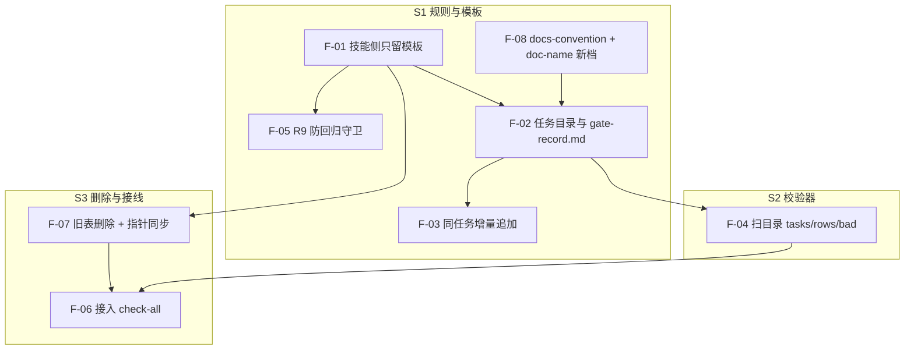

# 出口签字账迁到 `docs/devworkflows/`（技术改造 PRD）

> 状态：**已定稿（技改直通，2026-11-05；用户点头「执行吧」，免议会 #1 / #2）**
> 类型：**技术改造**（不改产品功能点、不改签字角色、不改六列口径）。按用户裁定**不进议会**，由 `reviewer-audit` 与 `senior-sdet` 同批审查留痕（见 §0.2 U-7）。
> 目标：把出口签字账从技能包 `skills/dev-workflow/references/gate-record.md`（350,182 字节 / 90 行）迁到**按任务分目录**的 `docs/devworkflows/<YYYYMMDDHHmmss>-<任务名>/gate-record.md`；旧表整份删除、不迁移；校验器与 `check-all` 接入新载体。
> 本文不是 spec：只定「要发生什么」与判据；脚本实现与 testcase 另起 spec，testcase 由 `senior-sdet` 在全新上下文编写。

---

## 0 裁决与事实基线

### 0.0 §0 四栏

| 栏位 | 内容 | 依据 | 状态 |
|---|---|---|---|
| 市场 | 无外部对标；只以仓内惯例为准（`docs/superpowers/` 与 `docs/research/` 都是「一主题一目录」） | `rules/docs-convention.md` 目录表与命名表；`scripts/doc-name.mjs:41`（`STAMP_DIRS`） | 已填（代拟） |
| 精算师 | 成本：删 1 份文件 + 新增 1 份模板 + 改 3 处脚本/规则；收益：技能包 377,660 → ≈31 KB、读表从十万 token 级降到千级。**不做迁移**，故无搬迁工时 | §0.3-1 / -8 / -9（实测命令可复算） | 已填（代拟，待签） |
| 产品经理 | 本文 §1–§10（代拟：主 agent） | 2026-11-05 本轮对话 | 已填（代拟） |
| 用户 | **已裁 7 件**（§0.2，原话逐字），含结构、删除、技改旁路三项方向性裁定 | 本次对话用户原话（可回溯） | **未签全栏**（精算师待签） |

> 技改类型：① 出口按用户裁定（U-7）走旁路，但本批**不满足** PRD §4.2「无新增交付物」的字面条件（新增模板与目录档），因此 gate 行必须写「用户裁定旁路（技改）」并由**审计**签字，且在当批 `impact-sheet.md` 留痕。这是对 §4.2 的一次显式例外，不是默认做法。

### 0.1 三档标记（全文通用）

| 标记 | 含义 | 处理 |
|---|---|---|
| `[已确认]` | 用户明确说过「认 / 就这么定」 | 抽查，有误推翻 |
| `[已决·代裁]` | 本轮按建议先定，用户未逐条表态 | 逐条划（§7） |
| `[待确认]` | 提议、用户未表态 | 逐条划（§7） |
| `[实测]` | 数字带取数命令，可复算 | 照抄命令核 |

### 0.2 用户已裁（2026-11-05，原话逐字）

| 编号 | 原话 | 落到本文 |
|---|---|---|
| U-1 | 「把签字放到reference里面，这个是skill部分，这个gate-guard，应该是每个docs/supoerpowers/下的对应项目一个吧」 | §1 病根①、§3.1 归属表 |
| U-2 | 「和对应的plan文件比如 `docs\superpowers\plans\2026-11-05-s6-b-boundary-convergence.md` 的平级」 | **被 U-6 取代**（改为任务目录） |
| U-3 | 「接入 check-all（推荐）」 | §5、F-06 |
| U-4 | 「你先出prd」 | 本文 |
| U-5 | 「旧账直接删掉就行了，要保障skill干净」 | §2.1 非目标、F-07 |
| U-6 | 「仿造supoerpowers的逻辑，我们在docs下建立devworkflows/，然后在下面建立时间戳+任务名称的文件夹，然后在下面存放每个任务需要的签名，只要是dev-workflow就会这么做」 | §3.2 结构、F-02 |
| U-7 | 「这个项目是技术改造类型，不用进议会，但是可以叫审计和你们一起审查清楚」 | §0.0 说明、§7 D-12 |

### 0.3 事实基线（cwd = 仓根）

| # | 事实 | 取数 |
|---|---|---|
| 1 | 旧表 `skills/dev-workflow/references/gate-record.md` = **350,182 字节** | `(Get-Item skills\dev-workflow\references\gate-record.md).Length` |
| 2 | 该文件 **148 行**、表体 **90 数据行** | 逐行以 `\|` 开头计数 |
| 3 | 90 行分布在 **28 个段标签 / 19 组**（本批不迁移） | 段列 `@` 后缀去重 |
| 4 | 90 行中 **89 行 >400 字符**、**87 行 >700**、89 行「核了什么」>250、**87 行「结论」>120**（段值只有 **6** 种） | 用仓内 `splitRow`（反引号内竖线不切）逐行计数；朴素 `split` 会误算成 78 |
| 5 | `skills/dev-workflow` 8 份文件合计 **377,660 字节**，旧表占 **350,182（93%）** | 目录求和 |
| 6 | 旧表被 **91 次提交**改动 | `git log --oneline -- <路径> \| Measure-Object` |
| 7 | `gate:record` 是独立 npm script，**不在** `check-all` 任何一段 | `Select-String -Path scripts\check-all.mjs -Pattern 'gate-record'` 命中 0；`package.json:10` |
| 8 | `doc-name.mjs`：`STAMP_DIRS = ['docs/prd','docs/after','docs/research']`；`DATE_DIRS = ['docs/superpowers/specs','docs/superpowers/plans','docs/handoffs']` | `scripts/doc-name.mjs:41-42` |
| 9 | `docs/` 现有 8 档：`after / agents / guide / handoffs / prd / reports / research / superpowers`；**无** `devworkflows` | `Get-ChildItem docs -Directory` |
| 10 | `scope-sweep.mjs` 的 `HISTORY_PREFIXES` 含 `docs/superpowers/plans/`、`docs/after/`、`docs/research/` 等；**不含**新目录 | `scripts/scope-sweep.mjs:21-28` |

---

## 1 要解决什么

| # | 病根 | 证据 | 后果 |
|---|---|---|---|
| ① | **归属错**：任务签字账写在技能包 `references/` | `rules/skill-assets-convention.md#L10`（`references\` = 按需加载的文档） | 技能随任务数线性膨胀；被分发/体检时背着别人的账 |
| ② | **全局混算**：一张表混装 19 组 / 90 行，判据在整表上算 | R6 计数、R3 存在性都在全局做 | 两任务并行 = 互相误伤 |
| ③ | **无守护**：`gate:record` 不在 `check-all`，无体积/行宽/归属判据 | §0.3-7 | 12 天涨 147 倍无人拦 |

**本质**：技能装「怎么判」，任务装「这次签了没」；现在两者混在一处。

---

## 2 范围

### 2.1 非目标

| 非目标 | 假设 / 理由 |
|---|---|
| **不迁移旧账** | U-5：90 行不拆、不建历史任务目录；旧表整份删除，历史由 git 承担（`git show <删除提交>^:<旧路径>`） |
| 不改六列表头与列序 | 六列被 `SKILL.md`、5 份 `stage-*.md`、校验器、docgen 测试同时依赖 |
| 不改签字角色、不改 R2「不得自签」 | 只换载体，不动「谁签谁」 |
| 不改 `docs/superpowers/` 现有六类 | spec / plan / review / retro / handoff 的语义与命名都不动 |
| 不建「归档 + 索引」机制 | 任务目录随任务走；旧表删除提交即归档 |

### 2.2 载体改动清单（R8 回扫）

| 位置 | 现状 | 处置 |
|---|---|---|
| `rules/dev-workflow-mainline.md:8` | 唯一证据载体 = `skills/dev-workflow/references/gate-record.md` | **改**：格式唯一源 = `references/gate-record-template.md`；实例 = `docs/devworkflows/<任务>/gate-record.md` |
| 同文件 R3 / R6 两行 | 「在 `gate-record.md` 中各有行」 | **改**：R3 逐任务目录 + 阶段门；R6 逐任务目录 ≤ 1 |
| 同文件 `:56` / `:66` | 验证命令输出 `rows N bad 0` | **改**：`node scripts/check-gate-record.mjs` 输出 `tasks N rows R bad B`；判据文字同步 |
| `rules/docs-convention.md` 目录表 / 命名表 / 时间戳总则 | 无 `docs/devworkflows/` 档 | **改**：新增一档（任务进行中可追加、收口后原文保留）+ 命名行 `YYYYMMDDHHmmss-<任务名>/`，子文件不加戳 |
| `skills/dev-workflow/SKILL.md:14-19`（6 行） | 「产出 `references/gate-record.md` 的表格行」 | **改**：产出本任务 `docs/devworkflows/<任务>/gate-record.md` 的一行 |
| 同文件 `:33` / `:59` / frontmatter `:3` | 旁路段与「唯一证据载体」句、description | **改**：载体换新路径；description 补「签字账落 `docs/devworkflows/`」 |
| `references/stage-1-prd.md:3-6` / `:42` | 入口条件、产出 ① 行 | **改**：① 入口加「建任务目录 + 建 gate-record.md」；出口指向新载体 |
| `stage-2-tech-design.md:5` / `:8` / `:43` / `:64` | 上段行已齐 / 旁路写法 / 增量先例 / 产出 ② 行 | **改**：换载体 |
| `stage-2b-plan-gate.md:5` / `:10` / `:64` | 同上（含旁路） | **改**：换载体 |
| `stage-3-implementation.md:5` / `:39` | 同上 | **改**：换载体 |
| `stage-4-quality.md:5` / `:55` / `:57` | 同上；impact-sheet 时序句 | **改**：只换载体名，判据不动 |
| `stage-5-delivery.md:5` / `:39` | 同上 | **改**：换载体 |
| `references/gate-record.md` | 350,182 字节 / 90 行 | **删除**（F-07） |
| `references/gate-record-template.md` | 不存在 | **新增**（F-01，六列口径 + 填法 + R1–R9 + 一行占位示例） |
| `scripts/check-gate-record.mjs` | 读单文件、输出 `rows N bad B` | **改**：扫 `docs/devworkflows/*/gate-record.md`；输出 `tasks/rows/bad`；R3 阶段门；体积/行宽 |
| `scripts/check-gate-record.test.mjs:102-107` | P63 断言真实旧表全绿 | **改**：扫目录；删「旧表」断言 |
| `scripts/check-all.mjs` | 无 gate-record 段 | **改**：新增一段，独立退出码，不走 `CHECK_BYPASS` |
| `scripts/doc-name.mjs:41` + `doc-name.test.mjs` | `STAMP_DIRS` 无新目录 | **改**：加 `docs/devworkflows`；补一条测试用例 |
| `agents/senior-sdet.md:75`、`reviewer-audit.md:88`、`detective-observer.md:70` | 「不得写 `skills/dev-workflow/references/gate-record.md`」 | **改**：不得写 `docs/devworkflows/**/gate-record.md` |
| `tools/docgen/templates/boundary.md.tpl:5` + `components/renderBoundary.mjs:30` | 写死技能侧路径 | **改**：常量换新路径 |
| `tools/docgen/test/tool-tiers.test.mjs:239/258/524/529`、`sc-card-shape.test.mjs:1001`、`s2-card-rewrite.test.mjs:1041`、`dev-workflow-files.test.mjs:28-37` + `:385-393`、`s3-predicates.test.mjs:160`、`support/dev-workflow-checks.mjs:96` | 断言指向旧路径 / 旧七份清单 / P62 | **改**：路径与断言同步；`references` 仍 7 份（删 1 增 1）；**P62 用例删除**（锁定对象已删） |
| `tools/scope-sweep/keywords.json:101`（I11 scope） | 含旧文件路径 | **改**：移除旧路径；**不登记新路径**（新文件不在 I11 scope，避免每行命令被当改判命中）；同批重冻结 `baseline.json` 的 I11 计数（现为 7）并在当批 impact-sheet 留痕 |
| `tools/docgen/policy/definitions/paths.mjs:25-34`（ledger 禁写组）+ `tools/docgen/test/policy-pure-source.test.mjs`（逐项相等断言） | 边界渲染的禁写清单不含新目录 | **改**：把 `docs/devworkflows/` 纳入 ledger 禁写组并同批改断言；不纳入则必须在本文写明理由（否则边界模板会允许 agent 写账本）。**本批裁决 = 不纳入**，理由：① 边界模板（`boundary.md.tpl`）与 `renderBoundary.mjs` 已用字面句禁止写 `docs/devworkflows/**/gate-record.md`，agent 侧禁写已生效；ledger 组只是 policy dump 的第二载体，不是唯一闸门。② 纳入会让定义层 19 项变 20 项，连动 15 席边界黄金哈希与 S6 计数断言全部重冻结，超出本批「技改 + 回扫」的处置面；要纳入请另开批次并同批重冻结。 |
| `rules/dev-workflow-mainline.md` 的 R1–R3 | 无「技改免议会」条款 | **改**：同批增补例外（定义 + ① 签字人 = 用户 + ② 签字人 = 审计 + impact-sheet 留痕），否则本批 ① 行没有规则依据（§7 D-13） |
| 上游签字 PRD：`docs/prd/20261024073606-dev-workflow-mainline/index.md`、`docs/prd/20261031202331-observable-criteria-rollout/index.md`、`docs/prd/20261026205821-agent-card-contract.md`、`docs/prd/20261102212627-card-data-contract-and-proof/index.md`（共 17 处命中） | 判据锚与历史签字件 | **停用横幅**：首段加「载体已迁至 `docs/devworkflows/`；旧路径于 <删除提交> 删除，`git show <sha>^:<旧路径>` 可取回」，正文不动（§7 D-11） |
| `docs/guide/skills/README.md:149`、`docs/guide/rules/README.md:127` | 活文档里的旧载体描述 | **改**：指向 `docs/devworkflows/<任务>/gate-record.md` |
| 历史文档（`docs/handoffs/**`、`docs/reports/**`、已定稿 spec / plan） | 删表后变死链 | **不改**：历史记录原文保留（`docs-convention` 硬约束 4）；需要时只在首段加「载体已迁」横幅 + 删除提交哈希，**不逐条删链** |

---

## 3 核心模型

### 3.1 三件东西的归属

| 东西 | 归属 | 形态 | 会随任务数增长吗 |
|---|---|---|---|
| **格式 / 怎么判** | 技能包 | `references/gate-record-template.md`（六列口径 + 填法 + 判据映射 + 一行示例） | 不会（≈4 KB） |
| **某任务的签字** | 项目文档 | `docs/devworkflows/<YYYYMMDDHHmmss>-<任务名>/gate-record.md` | 会，但**一任务一目录**，单份封顶 |
| **证据正文** | 项目文档 | `docs/reports/<批次>-evidence/` | 会，但不进任务账 |
| **判据实现** | 脚本 | `scripts/check-gate-record.mjs` | 不会 |

### 3.2 结构（仿 `docs/superpowers/` 与 `docs/research/` 的「一主题一目录」）

```
docs/devworkflows/
└── 20261105153000-gate-record-per-task/
    └── gate-record.md
```

- 目录名：`<YYYYMMDDHHmmss>-<任务名>`——时间戳 = **任务创建时刻**（① 入口那一刻），任务名 kebab-case（与 `docs/prd` / `docs/after` / `docs/research` 同属 14 位戳类）。
- 文件名：固定 `gate-record.md`（父目录已带戳，子文件不加前缀）。
- **一个任务 = 一次 dev-workflow 从 ① 走到 ⑤**；同一任务的后续增量（`-d17` / `-d19` / `-d23`）追加到同一份；新任务 = 新目录。
- 旁路任务（单点小改）**同样建目录**，`①` / `②` 行写「旁路 + 集合 diff 为空 + 无新增交付物」。
- spec / plan 仍在 `docs/superpowers/`；任务账只存签字行，证据用 `path:line` 指过去，不抄正文。
- **建目录动作**：`stage-1-prd.md` 的入口条件加一条——进 ① 前建任务目录，并从模板建 `gate-record.md`（模板尚未交付时允许按 §4.2 的字面表头手写一次）。

### 3.3 旁路与增量

- 旁路：`①` / `②` 行照写（不得省），签字人按 PRD §4.2（审计）。
- 增量：只追加不改原行 `结论`；`段` 列保留 `@批次` 后缀以区分同任务内的多次交付。

---

## 4 判据与门禁

### 4.1 R1：载体换了，「证据有效」不变

六列齐 + 证据非空/非「已核」+ 含可复算锚点；变化只在载体路径与上限。

### 4.2 单行与单份上限（修正 400 与列上限的自相矛盾）

| 判据 | 取值 | 依据 |
|---|---|---|
| 单份 ≤ | **40 KB** | 旧账最大单组 34,111 字节；新任务每份 5–7 行，远低于 |
| 整行 ≤ | **800 字符** | 六列分项上限之和 ≈780（段 30 + 判据 300 + 证据 250 + 申报人/签字人各 40 + 结论 120）；700 只覆盖两列，属拍脑袋值 |
| `出口判据` ≤ | **300** | 旧账该列中位 114、最大 539；新行取 300，与证据列合计可控 |
| `核了什么` ≤ | **250** | 短锚 + 指针（§4.3） |
| `结论` ≤ | **120** | 结论句，不含证据 |
| 存量豁免 | **无**（旧行已删） | U-5 |

超 40 KB 时按 §4.3 把长证据外迁到 `docs/reports/<批次>-evidence/`，只留短锚；不拆任务、不改结论。

### 4.3 证据仍在报告目录

「核了什么」= 一个可复算锚点（命令首行 / `path:line`）+ 证据正文所在报告文件；正文不抄进格。

### 4.4 R3 / R6：逐任务目录 + 阶段门

| 判据 | 改为 | 为什么 |
|---|---|---|
| R3 议会两插点 | **逐目录 + 阶段门**：段值只认六种字面 `①` / `②` / `②→③` / `③` / `④` / `⑤`（先 trim；`② -> ③` 之类漂移 → 红）；文件内出现 `②→③` 及之后的行时，必须已有 `①`、`②` 行且结论非空；只有 `①` 行（任务刚起）不判 | 逐目录才能真判「本项目内」；阶段门排除「任务进行到 ② 之前」的合法中间态；段值白名单防 `②→③` 被首字符误当 `②` |
| R6 拆 spec 中 ≤ 1 | **逐目录** ≤ 1，且**只数数据行**的段 / 状态格，不数全文 | 计数型判据必须逐份；数全文会把模板里的「拆 spec 中」说明文字算进去（新账一出生就 1 次） |

### 4.5 R9：技能不得装任务账（防回归）

`skills/**/references/*.md` 出现真实签字六列数据行，或出现「申报人 + 签字人」表头行且文件不是 `gate-record-template.md` → 红；`[[...]]` 占位示例行不计。

**模板自身不得触发判据**：模板只许有**一个** 6 列数据示例行（`[[...]]` 占位，R1 跳过、R9 豁免），其余说明用 2 列表或正文；R6 不计模板路径。校验器必须带「整份复制模板」负例（复制即应绿，不得因模板里的说明表格被判红）。

### 4.6 门禁接入

`check-all` 新增一段（独立退出码，不走 `CHECK_BYPASS`），判据单源 `scripts/check-gate-record.mjs`；输出 `tasks N rows R bad B`。

**`tasks 0` 的判定**：**红（fail-closed）**。首个任务目录由本任务自己在 S1 建立（§7），机制接入后 `tasks ≥ 1` 恒成立；这样「从不建账」不会静默全绿。任务目录存在但缺 `gate-record.md` 也判红（逐目录要求**恰 1 份**）。

---

## 5 功能点清单

| ID | 功能点 | 归属 | 进流程图 | 验收判据（可观测） |
|---|---|---|---|---|
| F-01 | 技能侧只留模板 `references/gate-record-template.md`（无真实签字行） | 技能 | 是 | 文件存在；references 恰 7 份；`[[...]]` 占位示例行 ≤1；R9 exit 0 |
| F-02 | 任务目录 `docs/devworkflows/<YYYYMMDDHHmmss>-<任务名>/gate-record.md`，① 入口建立 | 文档 | 是 | 静态检查：目录存在 + `gate-record.md` 存在 + 表头六列在位 + 至少 1 行 `①`；目录名匹配 `^\d{14}-[a-z0-9][a-z0-9-]*$`；每个任务目录**恰 1 份** `gate-record.md`（缺/多 → 红） |
| F-03 | 同任务增量追加到同一份，不改原签结论 | 文档 | 是 | 增量提交相对上一版的 diff **只新增行**（`git diff <上一版> -- <file>` 的删除行数 = 0）；原行六格与上一版逐格相等（用 `splitRow` 切格比对，不按整行 diff） |
| F-04 | 校验器扫目录：`tasks N rows R bad B` + R1/R2/R3（阶段门）/R6 + 体积/行宽 + 目录名 | 脚本 | 是 | 输出三段数字；`bad` = 行级问题 + 文件级问题（缺文件 / 表头错 / 目录名错）；`tasks 0` → exit 1；超上限报 `path:line` 与实测值 |
| F-05 | R9 守卫（§4.5） | 脚本 | 是 | 故意在 references 插一条真实签字行 → 红；删掉 → 绿 |
| F-06 | 接入 `check-all` 新段 | 门禁 | 是 | `npm run check` 输出含该段；该段红时全仓红；BYPASS 不跳过该段 |
| F-07 | 旧表删除 + 消费方指针同步（§2.2） | 复用 | 是 | 旧表不存在；`git show <删除提交>^:<旧路径>` = 148 行 / 90 数据行；§2.2 每个「改」都已改；`scope-sweep --check` exit 0 |
| F-08 | `docs-convention` 新增 `docs/devworkflows/` 档 + `doc-name.mjs` 加 `STAMP_DIRS` + 测试 | 规则/脚本 | 是 | 规则目录表/命名表含该档；`npm run doc:name` 对新建任务目录 exit 0；测试含该用例 |

### 5.1 主干流程图（8 节点）



**互校**：图节点 8 = 上表「进流程图＝是」8 行；§8 每件可交付物都能指到 §5 的 F。

---

## 6 决策清单（逐条可推翻）

| ID | 决策项 | 建议 | 状态 |
|---|---|---|---|
| D-01 | 载体落点 | `docs/devworkflows/<YYYYMMDDHHmmss>-<任务名>/gate-record.md` | `[已确认]`（U-6） |
| D-02 | 「一个任务」的定义 | 一次 ①→⑤ 交付；同任务增量追加，新任务新目录 | `[已决·代裁]` |
| D-03 | 旧表去留 | 整份删除，不迁移、不改写 | `[已确认]`（U-5） |
| D-04 | 历史可追溯性 | git（删除提交 + `git show`）；不建归档件 | `[已决·代裁]` |
| D-05 | R3 口径 | 逐任务目录 + 阶段门 | `[已决·代裁]` |
| D-06 | R6 口径 | 逐任务目录 ≤ 1 | `[已决·代裁]` |
| D-07 | `tasks 0` | **红（fail-closed）**；任务目录缺 `gate-record.md` 也红 | `[已决·代裁]`（首个任务目录由本任务 S1 自建，故不误伤） |
| D-08 | 行宽上限 | 整行 ≤800、`出口判据` ≤300、`核了什么` ≤250、`结论` ≤120、单份 ≤40 KB | `[已决·代裁]`（§4.2；700 只覆盖两列） |
| D-09 | 模板形态 | 六列 + 口径 + 填法 + R1–R9 + 一行 `[[占位符]]` 示例 | `[已决·代裁]` |
| D-10 | R9 范围 | references 全扫；模板与占位行豁免 | `[已决·代裁]` |
| D-11 | 历史死链 | **活文档改路径**（`docs/guide` 2 处）；**历史件与上游 PRD 不逐条删链**，只加「载体已迁 + 取回锚点」横幅。取回锚点 = `git log --diff-filter=D -1 --format=%H -- skills/dev-workflow/references/gate-record.md` 的输出（本批提交后可得，故横幅写该命令而不是硬编码 sha；⑤ 交付行复核该命令能取到 sha） | `[已决·代裁]`（用户原话「死链删掉就行了」；审计 P0 指出删链会抹掉历史因果指针，故降级为横幅） |
| D-12 | 本批流程 | 技改旁路、不进议会；审计 + sdet 审查留痕 | `[已确认]`（U-7） |
| D-13 | U-7 的规则依据 | 同批在 `rules/dev-workflow-mainline.md` 增补「用户裁定技改免议会」例外（定义 / ① 签字人 = 用户 / ② 签字人 = 审计 / impact-sheet 留痕）；否则本批 ① 行无规则依据 | `[已决·代裁]`（审计 P0） |

---

## 7 交付拆分

| 份 | 内容（每件带归属 F） | 依赖 | 状态 |
|---|---|---|---|
| **S1** 规则与模板 | ① `docs-convention` 新档 + `doc-name` 加项 + 测试（F-08）② `references/gate-record-template.md`（F-01）③ R9 检查点（F-05）④ 任务目录口径写进 `stage-1`（F-02/F-03 的规则面）⑤ **本任务自己的目录与 `gate-record.md`（首个实例，含本批 ①②②→③ 行）** | 无 | 未开始 |
| **S2** 校验器 | ① `check-gate-record.mjs` 扫目录 + `tasks/rows/bad` + R3 阶段门 + 目录名 + 上限（F-04） | S1 的模板与目录档 | 未开始 |
| **S3** 删除与接线 | ① 删除旧表 + §2.2 指针同步 + `docs/guide` 2 处改路径 + 上游 PRD/历史件加横幅 + `keywords.json` 移除旧路径 + baseline 重冻结（F-07）② `check-all` 新段（F-06）③ R1–R3 增补「技改免议会」条款（D-13） | S1、S2 | 未开始 |

**顺序：S1 → S2 → S3。** 理由：① 目录档与模板先落地，S2 才有唯一列口径、S3 删除才有落点；② 校验器先于删除，删除前后都有人核；③ 删除与指针同步同批，避免旧路径与新判据并存。

**F → S**：F-01/F-05/F-08 → S1；F-02/F-03 的规则面 → S1；F-04 → S2；F-06/F-07 → S3。

---

## 8 验收

### 8.1 文档自身（V 组）

| # | 验收项 | 可核方式 |
|---|---|---|
| V-1 | F 清单与流程图双向一致 | §5 表「进流程图＝是」8 行；§5.1 图节点 8 个；差集 0 |
| V-2 | 事实基线与用户原话可复算 / 可追 | §0.3 十条逐条跑命令；§0.2 七条逐字核对 |
| V-3 | §7 每件可交付物都指到 F | 逐件核，孤儿 0 |
| V-4 | 非目标全且每条带假设 | §2.1 五条，理由列非空 |
| V-5 | 每个 F 都有可观测判据 | §5「验收判据」列 8 行全非空，无「合理/体验」类形容词 |

### 8.2 产品级（P 组）

| # | 验收项 | 可核方式 |
|---|---|---|
| P-1 | 技能包 ≤40,960 字节 | `skills/dev-workflow` 目录求和 |
| P-2 | 旧表已删且历史可取回 | 旧路径不存在；`git log --diff-filter=D -1 -- <旧路径>` 取删除提交；`git show <sha>^:<旧路径>` = **148 行 / 90 数据行 / 350,182 字节** |
| P-3 | 校验器与门禁绿 | `node scripts/check-gate-record.mjs` 输出 `tasks/rows/bad`；`npm run check` 末行通过且含新段 |
| P-4 | 新任务账合规 | 目录名合规 + 恰 1 份 `gate-record.md` + 6 列表头；行宽/体积全绿 |
| P-5 | `tasks 0` 行为 | 空目录 → exit 1；有任务时按判据判 |
| P-6 | R8 回扫绿 | `node scripts/scope-sweep.mjs --check` exit 0（含 I11 baseline 重冻结） |
| P-7 | 命名合规 | 校验器内置目录名检查 exit 0；`npm run doc:name` 亦绿 |
| P-8 | 活文档无残留 | `rules/`、`skills/`、`agents/`、`docs/guide/` 中旧路径命中 0；历史件保留原文 + 横幅 |

---

## 9 风险清单（已并入 sdet / 审计意见：12 + 12 条）

| # | 风险 | 影响 | 缓解 |
|---|---|---|---|
| R-01 | 任务边界主观（什么算一个任务、增量何时新开） | 目录数量与判据都依赖它 | D-02 定义 + 审计按「是否一次 ①→⑤」判 |
| R-02 | `tasks 0` 绿会掩盖「机制上线后从不建账」 | 静默漏签 | 改为 **fail-closed 红**；首个任务目录由本任务 S1 自建（D-07） |
| R-03 | 时间戳依赖本机时钟，跨机器可能乱序 | 排序误导 | 只作身份与排序，不作判据；同秒冲突加任务名去重 |
| R-04 | 目录数量随任务增长（一年数百个） | 目录浏览与扫描成本 | 扫描只读 `*/gate-record.md`；可后续加分页索引（非本批） |
| R-05 | 旧账删除后历史不可核 | 旧出口无法复核 | 已被 U-5 接受；git 可取回 |
| R-06 | 历史文档逐条删链会改写历史文本 | 与 docs-convention 冲突、审计证据断链 | 改为「历史件横幅 + 活文档改路径」（D-11）+ R8 留痕 |
| R-07 | `②→③` 被首字符误当 `②` | 阶段门静默跳过（假绿） | 段值白名单六字面，未知段值红（§4.4） |
| R-08 | 行宽 800 / 判据 300 是新取值，缺实测 | 新行可能仍超 | S2 用首批 5 个任务实跑校准；超限按 §4.3 外迁 |
| R-09 | 旁路任务是否都要建目录 | 小改膨胀目录 | skill description 已把单点修复导向 review-loop；dev-workflow 任务才建账 |
| R-10 | `docs/agents/` 生成物与边界模板同步遗漏 | 文档与规则不一致 | §2.2 已列 docgen 模板/渲染器/4 处测试；`npm run check` 兜底 |
| R-11 | **删链扩面**：`docs/prd/` 内就有 61 处命中（5 份文件），含上游 PRD | 抹掉历史因果指针 | D-11 降级为「活文档改、历史件横幅」，不逐条删 |
| R-12 | **模板自噬**：模板里的 6 列说明表 + `[[占位]]` 行会被当数据行 | 新账一出生就红；放宽又会让 R1 判空 | 模板只留一个 6 列示例行、其余用 2 列表；校验器跳过 `[[` 行；加「整份复制模板」负例（§4.5） |
| R-13 | **目录无文件静默绿**：只扫 `*/gate-record.md`，建了目录不写文件则不可见 | 假绿 | 逐目录要求恰 1 份；缺则红（F-04） |
| R-14 | **R6 数全文**：模板里的「拆 spec 中」说明被算 1 次 | 新账 1 行即 2 | R6 只数数据行的段 / 状态格（§4.4） |
| R-15 | **命名无门禁**：`npm run check` 不含 `doc:name` | 中文/大写任务名只在手动命令红 | 校验器内置目录名检查 + P-7 双保险 |
| R-16 | **上游漏扫**：3 份 PRD（17 处）与 `docs/guide` 2 处未进 §2.2 | R8 回扫不完整 | 已补入 §2.2（横幅 / 改路径） |
| R-17 | **U-7 免议会无规则依据** | 本批 ① 行判不出合法性 | D-13：同批增补 R1–R3 例外条款 |
| R-18 | **`bad` 口径**：R3/R6 是文件级 reason，不含在 `bad` | 「bad 0」可与 exit 1 并存 | `bad` = 行级 + 文件级（F-04） |
| R-19 | **自应用空窗**：S1/S2 期间本批门行写哪儿 | 本批 ①② 行无落点，S3 删旧表会连带删掉 | S1 ⑤：先建本任务目录并落本批 ①②②→③ 行，再在 S3 删旧表 |

---

## 附录 A　skill 内改动一览（U 问「这个修改涉及到的 skill 改动」）

| 文件 | 改动 |
|---|---|
| `skills/dev-workflow/SKILL.md` | 段表 6 行（`:14-19`）载体换新路径；`:33` 旁路段；`:59` 唯一证据载体句；`description` 补「签字账落 `docs/devworkflows/`」；段表前加「① 入口建任务目录」 |
| `references/stage-1-prd.md` | 入口条件加「建目录 + 建 gate-record.md」；`:42` 产出 ① 行换载体 |
| `references/stage-2-tech-design.md` | `:5` / `:8` / `:43` / `:64` 换载体（含旁路与增量先例） |
| `references/stage-2b-plan-gate.md` | `:5` / `:10` / `:64` 换载体 |
| `references/stage-3-implementation.md` | `:5` / `:39` 换载体 |
| `references/stage-4-quality.md` | `:5` / `:55` / `:57` 换载体（impact-sheet 判据不动） |
| `references/stage-5-delivery.md` | `:5` / `:39` 换载体 |
| `references/gate-record.md` | **删除** |
| `references/gate-record-template.md` | **新增**（六列 + 口径 + 填法 + R1–R9 + 一行占位示例） |

references 仍 7 份（删 1 增 1）。

非 skill 但同批必改（详见 §2.2）：`rules/docs-convention.md`（新增目录档）、`rules/dev-workflow-mainline.md`（载体 + R3/R6 + 技改例外）、`docs/guide/{skills,rules}/README.md`（2 处旧载体描述）、`tools/docgen/policy/definitions/paths.mjs`（ledger 禁写组）、上游 3 份 PRD（横幅）。

## 附录 B　与旧方案差异（留痕）

| 项 | 旧方案（skills 单表 / plans 平级 / 迁移） | 本 PRD |
|---|---|---|
| 技能包 | 装全部签字行 | **只留模板** |
| 账本落点 | `references/` 单表 → `plans/<plan>-gate.md` | `docs/devworkflows/<任务>/gate-record.md` |
| 任务锚 | plan（②→③ 才存在） | **任务目录（① 就存在）** |
| 旧账 | 迁 17 份 | **整份删除**（U-5） |
| 流程 | 进议会 | **技改旁路**（U-7），审计 + sdet 审查 |
