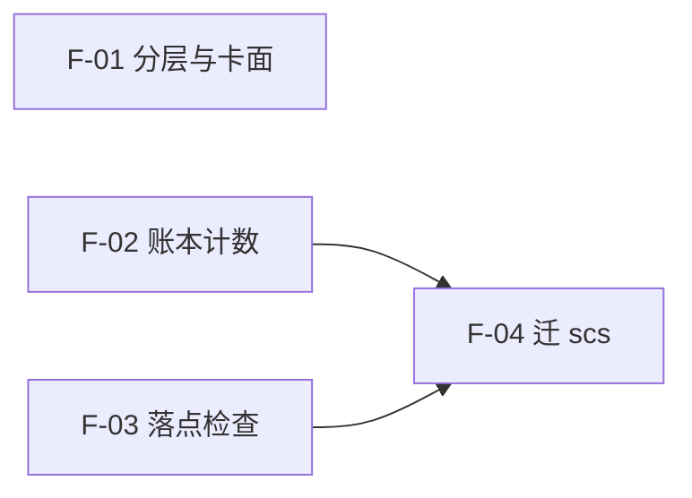

# 脚本分层与运行期收口（PRD）

> **状态**：已交付（S1–S4 全部实现；`npm run check` 末行 `check 全部通过`；出口签字见 `docs/devworkflows/20261109211349-script-layer-refactor/gate-record.md`）｜**创建** 2026-11-09 21:13:49｜**来源**：`tmp/agent-criteria-demo/result.md` §5.1 #3 / #5、§6 #3、§8.4、§8.6（2026-11-09 讨论结论）＋ 用户同日追问「哪些要迁 scs」——首版漏了这一维，本版补 §3.4 / §4.3 / §6；同日与 `stage-2b-testcase-sdet.md` 三轮对账，补 P7 / D15 / D16
> **适用范围**：仓库内 `.mjs` 脚本的归属判断（构建期 / 开发期 / 运行期 / 公共 CLI `scs`）、agent 卡面命令白名单、轮间核对单里机械项的脚本化、校验器的数据面。
> **回答目标**：① 一段脚本该放哪（本仓哪一层，还是该搬进 `scs`）；② 卡面该写哪几条命令；③ 哪些「人工判定」可以先改成脚本；④ 校验器读什么数据、判到什么程度；⑤ 哪些现有脚本需要迁到 `D:\Seed\skill-common-script`。
> **不适用**：卡面文案删改（见 result.md §3）、越界处置（§8.1–§8.3）、八条判据逐条改造（§5.1 #6）、输出格式改指针的规范冲突（§8.5）。
> **基线状态**：result.md 页首记录的越界改动已由 revert 提交 `376ab88` 撤回（`git log --oneline -3` 输出末三行：`376ab88` / `776c068` / `360e307`）；`git status --porcelain` 无输出 → 本 PRD 从干净工作区起算。
> **口径**：所有数字附取数命令；未复验的继承断言在 §8 单列，不混进结论。

## 1 要解决什么

| # | 问题 | 现状证据 |
|---|---|---|
| P1 | **三种生命周期的命令混在同一张白名单**：卡面点名 3 组，组内既有仓库自检、生成器命令，也有平台工具 | 卡面只点名组不展开（`agents/reviewer-audit.md:92`）；3 组共 14 条 verb，按内容分：开发期 4（`check.local` 前 4 条）+ 构建期 4（`docgen.read` 全部）+ 运行期 6（`git.read` 5 + `scs time` 1）（§2-1、§2-2） |
| P2 | **运行期脚本没有落脚点**：议会账本只有模板，没有可随技能拷走的脚本 | `skills/parliament-ledger/` 共 4 个文件（`SKILL.md` + `assets/` 三份），`scripts/` 不存在（§2-3）；模板由构建期生成器投影（`tools/docgen/builders/agents/ledger.mjs:11`） |
| P3 | **三个机械项仍标「人工判定」**：计数、落点、证据重放 | 卡上 #4 计数、#6 落点、#7 证据重放，类型列全为「人工判定」（`agents/reviewer-audit.md:43` / `:45` / `:46`）；模板自述「心算必错，实测数错 3 次被拦」（`skills/parliament-ledger/assets/round-check.md:4`） |
| P4 | **「可跨仓」判据失真**：只看 `import.meta.url` 会把绑死本仓的脚本误判为运行期 | `skills/rule-inspector/scripts/score.mjs` 用 `import.meta.url` 定位自身，却读 `../../../tools/...`（`:4` / `:15` / `:18`）→ 拷进别的仓即断 |
| P5 | **校验器没有稳定数据面**：模板文字已有唯一源，但校验器若另写字段清单就是第二份真相 | `ledger.mjs:1-2` 声明模板文字唯一源 = `outputFormats.mjs` 的 `docs`，本文件只做投影 |
| P6 | **缺「是否迁 scs」这一维**：只分了「住本仓哪一层」，没问「该不该住本仓」。`scs` 已有账本计数，首版却另提新建 `count-ledger.mjs` | `D:\Seed\skill-common-script\README.md:31-38` 已列 `ledger gate` / `ledger numbers`；`src/commands/ledger-numbers.ts:55-199` 已实现 C1–C4；首版 §4.1 / §4.3 写的是新建技能脚本 |
| P7 | **迁移会打断既有 170 条测试用例**：用例把脚本路径、数据根、`--root` 语义写死 | `stage-2b-testcase-sdet.md:13` 用 `node scripts/check-criteria-engine.mjs --root`；实测该文件不存在（§2-17），2026-11-08 已迁 scs（§2-18）；数据根也由 `tools/quality/criteria-engine/` 迁到 `tools/docgen/{dsl,builders}/rules/`（§2-19） |

## 2 事实基线（全部可复算）

| # | 事实 | 取数命令 | 结果 |
|---|---|---|---|
| 1 | 允许命令 = 3 组 / 14 条 verb | `node -e "const m=await import('./tools/docgen/builders/agents/policy/definitions/commands.mjs');const g=m.commandGroups;console.log(Object.entries(g).map(([k,v])=>k+'='+v.verbs.length).join(' '),'total='+Object.values(g).reduce((n,v)=>n+v.verbs.length,0))"` | `check.local=5 git.read=5 docgen.read=4 total=14` |
| 2 | 卡面只点名组名，不展开命令 | `(Get-Content agents\reviewer-audit.md)[91]` | `**命令默认拒绝**：只跑本席策略 commandGroups 的 check.local / git.read / docgen.read 白名单组，其余一律不跑（逐条命令不在本卡重复）。` |
| 3 | 账本技能无 `scripts/` | `"files=" + (Get-ChildItem skills\parliament-ledger -Recurse -File).Count; "scripts=" + (Test-Path skills\parliament-ledger\scripts)` | `files=4` / `scripts=False` |
| 4 | 模板由构建期生成器写盘 | `tools/docgen/builders/agents/ledger.mjs:9-11` | `OUT = path.join(ROOT, 'skills', 'parliament-ledger', 'assets')` |
| 5 | 开发期脚本写死「上一级是仓库根」 | `scripts/check-all.mjs:34` | `const root = resolve(dirname(fileURLToPath(import.meta.url)), '..')` |
| 6 | 技能内脚本引技能外资源 | `skills/rule-inspector/scripts/score.mjs:4` / `:15` / `:18` | 三处 `../../../tools/...` |
| 7 | 技能内脚本的兜底写法 | `skills/skill-inspector/scripts/check.mjs:20-25` | 动态 import `../../../scripts/skill-dir.mjs`，失败时走 `listSkillDirsFallback` |
| 8 | 公共 CLI 的根目录默认值 | `scs check criteria-engine --help` | 选项行：`--root <dir>  项目根（默认当前目录）` |
| 9 | 审计卡清单 7 条，全为人工判定 | `(Select-String -Path agents\reviewer-audit.md -Pattern '^\| \d+ \| 审计席卡').Count`；同式加 `.*人工判定` | `7` / `7` |
| 10 | 模板 6 项，其中第 3、5 项自述为机械计数项 | `skills/parliament-ledger/assets/round-check.md:4` / `:14` / `:16` | 「机械计数项（第 3、5 项）证据栏必须写取数命令 + 输出……心算必错，实测数错 3 次被拦」 |
| 11 | `package.json` 现有 npm 入口 | `node -e "const p=require('./package.json');console.log(Object.keys(p.scripts).length)"` | `9` |
| 12 | `scs` 已装并可跑 | `scs --version` | `0.1.0` |
| 13 | `scs` 已有命令（含账本两项） | `D:\Seed\skill-common-script\README.md:31-38` | `help` / `time` / `check observable` / `check criteria-engine` / `ledger gate` / `ledger numbers` |
| 14 | `scs ledger numbers` 已做账本计数 | `src/commands/ledger-numbers.ts:55-199` | C1 算术自洽 / C2 卡片实数 / C3 族号计数 / C4 副本禁令；**C2 只认含「卡级」+「张」的声明** |
| 15 | 技能内运行期脚本共 3 个技能 / 10 个文件 | `Get-ChildItem skills -Directory \| ForEach-Object { $s=Join-Path $_.FullName 'scripts'; if (Test-Path $s) { Get-ChildItem $s -File \| ForEach-Object { $_.Directory.Parent.Name + '/' + $_.Name } } }` | `rule-inspector` 4 / `skill-inspector` 2 / `use-rule-skills` 3 个 `.mjs` + 1 个 `package.json` |
| 16 | `skill-dir.mjs` 的消费方 | `Grep 'skill-dir\.mjs'` | 3 处：`scripts/check-all.mjs:13`、`skilldependencies/validate.test.mjs:8`、`skills/skill-inspector/scripts/check.mjs:22`（动态 import + 兜底） |
| 17 | 阶段 2b 用例假设的脚本路径已不存在 | `Test-Path scripts/check-criteria-engine.mjs`；`Test-Path tools/quality/criteria-engine`；`(Get-ChildItem rules -Filter *.md).Count` | `False` / `False` / `1` |
| 18 | 公共脚本迁出的提交 | `git show -s --format="%h %ci %s" ed7b40c` | `ed7b40c 2026-11-08 13:29:27 +0800 refactor: 公共脚本迁出至 skill-common-script，门禁改调 scs` |
| 19 | 判据引擎现落点 | `Get-ChildItem tools\docgen\builders\rules -File`；`Get-ChildItem tools\docgen\dsl\rules -File` | 引擎/投影：`build.mjs` `schema.mjs` `interpreters.mjs` `rules.mjs` + 5 份 md；数据：5 份 json + 5 份 testcase + `rules.json` |
| 20 | `scs` 默认值仍指旧仓布局 | `D:\Seed\skill-common-script\src\commands\check-criteria-engine.ts:43-47` | `DEFAULT_ENGINE_DIR='tools/quality/criteria-engine'`、`DEFAULT_TERMS_FILE='tools/quality/observable-terms.json'`、`DEFAULT_SURFACES=['skills','tools/quality']`，注释「布局默认值 = 旧仓形态」 |
| 21 | `scs` 命令测试覆盖 | `Get-ChildItem ...\src\commands -Filter *.ts` 与同名 `.test.ts` 比对 | 实现 8 / 测试 5；无 test 的 3 个是 `check`、`help`、`ledger`（纯分发） |

> 已收口、不再重开：模板两份真相（`outputFormats.mjs` 与 `skills/parliament-ledger/assets` 各一份）已于 2026-11-09 收口为「唯一源 + 投影」（`ledger.mjs:1-3`）。本 PRD 只沿用该结论。

## 3 分类与判据

### 3.1 三层

| 维度 | 什么时候跑 | 谁跑 | 应在哪 | 随套件分发 |
|---|---|---|---|---|
| **构建期** | 改数据后重新生成 | 开发者 / CI | `tools/docgen/builders/` | 否 |
| **开发期** | 提交前 / CI | 开发者 | `scripts/` | 否 |
| **运行期** | AI 干活时 | agent / skill | `skills/<名>/scripts/` | 是 |

### 3.2 判定顺序

先看**根目录从哪来**，再看**谁调用**，最后看**能不能随套件拷走**。三者冲突时，以「拷走后能否跑通」为准。

| 根目录来源 | 例子 | 能否跨仓 | 归层 |
|---|---|---|---|
| 所引资源全在技能目录内（或自带兜底） | `skills/skill-inspector/scripts/check.mjs:20-25` | 能 | 运行期 |
| 路径全部经参数传入（`--root` 默认当前目录） | `scs check criteria-engine`（§2-8） | 能，任意仓库 | 运行期 / 通用工具 |
| 写死「上 N 级是仓库根」 | `scripts/check-all.mjs:34`、`skills/rule-inspector/scripts/score.mjs:15` | 不能 | 开发期 / 构建期 |
| 只由生成流程调用 | `ledger.mjs --apply`（§2-4） | 不能 | 构建期 |

**对 result.md §8.6 的修正**：原文写「写死自身位置（`import.meta.url`）→ 能跨仓」，实测不成立——`score.mjs` 用 `import.meta.url` 定位自身，但仍读 `../../../tools/...`，拷走即断（§2-6）。真正判据是「**所引资源是否全在技能目录内，或全部经参数传入**」，不是「用了哪种定位方式」。

### 3.3 结论

| # | 结论 | 依据 |
|---|---|---|
| D1 | 三层分类按 §3.1，落点不混住 | result.md §8.6 + §2-4/5/6 |
| D2 | 分界线 = 根目录写法 + 所引资源范围，不是脚本用途 | §3.2 修正；反例 §2-6 |
| D3 | **每个命令组**必须显式标 `layer: build｜dev｜run`，且**一组只装一个 layer**；混装组必须拆。缺标 / 混装 = 红 | 卡面授权单位是**组名**（`renderBoundary.mjs:72`），verb 级标注拦不住整组授权；`check.local` 5 条 = 4 开发期 + 1 运行期，不拆就会把 `npm run check` 一起授出 |
| D4 | 卡面命令白名单只渲染 `layer=run` 的组；`build` / `dev` 不进卡面 | result.md §8.6「14 条砍到 3-4 条」；按本口径现为 6 条 / 2 组（`git.read` 5 + `scs time` 1），最终形态见 §8-1 |
| D5 | **不跨仓**的运行期脚本住 `skills/<名>/scripts/`；跨仓的进 `scs`（D10）。两者都必须能在「只拷自身 + 参数传入」时跑通；`--root` 一律指**项目根**，数据根用 `--data` / `--engine` / `--projection` | §3.2；`scs check criteria-engine --help` 已把 `--root` 定义为项目根（§2-8） |
| D6 | 开发期 / 构建期命令只进 `package.json` 与 CI，不进卡面 | §2-5、§2-11 |
| D7 | `check.local` 组名与内容不符：它装的是开发期自检，应拆出运行期条目后改名 | result.md §8.6 派生结论；组名待 S3 定 |
| D8 | 机械项按风险递增脚本化：#4 计数 → #6 落点 → #7 证据重放 | #4 输入输出都在账本内；#6 需文件系统；#7 需跑命令、风险最高（`agents/reviewer-audit.md:43-46`） |
| D9 | 校验器只判痕：文件在不在、表头齐不齐、必填列非空；不判值合不合理 | result.md §8.4；后者归 residual 人工抽检 |
| D10 | 运行期脚本先问「能不能进 `scs`」，再问「放哪个技能」；本仓技能目录不是默认答案 | §3.4；`scs` 已是跨仓 CLI（§2-12/13） |
| D11 | 进 `scs` 的硬条件：① 有实现的子命令必须有同名 `*.test.ts`（纯分发 `check` / `help` / `ledger` 例外，§2-21）；② 默认值不得指向具体仓布局，仓相关路径必须由调用方显式传参；③ 不被本仓目录结构绑死。三条缺一 → 不进 | §2-20 显示现有默认值就是旧仓布局（软绑，且已漂）；§2-21 |
| D12 | **#4 计数不新建脚本**，扩 `scs ledger numbers`；缺口至少两条：① 终态对账（卡数 = 已修 + 关闭 + 候选 + 升级 + 带往下轮）；② 声明形态适配——C2 只认含「卡级」+「张」的声明，模板写的是「卡片数」 | §2-14；`ledger-numbers.ts:129` 的 `if (!/卡级/.test(decl) \|\| !/张/.test(decl)) continue`；`round-check.md:14` |
| D13 | **#7 证据重放不进 `scs`**：全局 CLI 不执行任意命令；`scs` 只做 `path:line` 存在性（并入 #6），命令重放留本席人工 | 安全边界；`scs` 现有命令均为只读校验 |
| D14 | 现有运行期脚本：`skill-inspector/check.mjs`、`rule-inspector/score.mjs` 迁 `scs`；`skill-dir.mjs` **保持本仓单源、不迁**；`check.mjs` 迁移后旧文件与兜底副本一并删除；`use-rule-skills/*` 留技能 | §3.4 候选表；R13（库形态不迁）；§2-16 |
| D15 | 迁移必须冻结三类契约：**命令**（exit code / 目标 code 串 / 首末行）、**路径**（数据根、产物路径）、**参数语义**（`--root` / `--data`）；迁移交付物含一张「旧路径 → 新命令」映射表 | `stage-2b-testcase-sdet.md:13` / `:20` 三类都写死；§2-17~19 |
| D16 | 新门禁（如 `check-command-layer.mjs`）必须先有 testcase 才算上线；本 PRD 的 V 系列只是验收，不替代 testcase | 与 sdet §5「不可测条目」同一口径（`stage-2b-testcase-sdet.md:342-355`） |

### 3.4 第四个去向：scs（公共 CLI）

首版只分了「本仓哪一层」，漏了「是否根本不该住本仓」。`scs`（`D:\Seed\skill-common-script`，`package.json:6-8` 的 `bin.scs`，TS + vitest）已承载跨仓命令（§2-13），其中 `ledger numbers` 已在做账本计数（§2-14）。

**四选一**

| 去向 | 装什么 | 判据 |
|---|---|---|
| `scs`（`D:\Seed\skill-common-script\src\commands\`） | 跨仓通用、入参化、有独立测试 | 不被本仓目录结构绑死；≥2 个仓会用；能在 `--root` 下跑 |
| `skills/<名>/scripts/` | 只服务本技能 | 依赖技能内的模板 / 约定 |
| `scripts/` | 本仓开发期 / CI | 依赖本仓目录结构（`docs/prd`、`tools/docgen` 等） |
| `tools/` | 本仓构建期 | 数据 → 产物流水线 |

**顺序**：先问「别的仓会不会用」→ 会 → `scs`；不会 → 再问「是不是本技能自带」→ 是 → 技能 `scripts/`；否 → 本仓 `scripts/` 或 `tools/`。

**候选清单（现有 + 拟建）**

| 现位置 | 功能 | 跨仓 | 建议 | 依据 |
|---|---|---|---|---|
| `scs ledger numbers`（已有） | 账本算术 / 卡片实数 | 是 | **#4 扩这里，不新建脚本** | §2-14；缺口见 D12 |
| `scs ledger gate`（已有） | 轮次账起止 / 耗时 | 是 | 保留 | `skills/parliament/assets/progress.md:25` 已调用 |
| `skills/skill-inspector/scripts/check.mjs` | 技能体检 | 是 | **迁 `scs`（`scs check skills`，名待定）** | 现靠兜底副本对抗「单源不在」（§2-7）；迁后删兜底 |
| `skills/rule-inspector/scripts/score.mjs` | 规则体检 | 是 | **迁 `scs`（`scs check rules`，名待定）** | 现读 `../../../tools/...`（§2-6），跨仓即断 |
| `skills/rule-inspector/scripts/gen-rule-checklist.mjs` | 生成检查单 | 待定 | 先留技能 | 依赖技能内模板与 ⑨ 项判据 |
| `skills/use-rule-skills/scripts/drafts.mjs` / `open-view.mjs` | 草稿箱 / 打开视图 | 否 | 留技能 | 绑本技能的草稿目录约定 |
| `scripts/skill-dir.mjs` | 「什么算技能目录」唯一判据 | 是 | **迁 `scs` 或抽公共库** | 纯函数、3 处消费（§2-16）；迁后删技能内副本 |
| `tools/observation-check/**` | 观察记录校验 | 待定 | 评估后迁 `scs check observations` | 目录锚（`.session/reviews`、`docs/superpowers/reviews`）是议会通用约定（`gate-run.mjs:12-16`） |
| `scripts/` 其余 12 个非测试脚本 | 本仓自检 / 文档命名 / 门记录 | 否 | 留 `scripts/` | 绑本仓目录与检查段（§2-5） |
| `tools/docgen/**` | 卡与模板生成 | 否 | 留 `tools/` | 本仓数据 → 产物流水线 |
| 拟建 #6 落点检查 | `path:line` 存在性 | 是 | **建在 `scs`（`scs check landings`，名待定）** | 纯文件系统检查，无仓专属 |
| 拟建 #7 证据重放 | 跑证据栏命令 | 是，但危险 | **不进 `scs`**（D13） | 全局 CLI 不执行任意命令 |

## 4 目标形态

### 4.1 目录

```
D:\Seed\skill-common-script\      # 跨仓运行期：scs 命令（现有；本 PRD 扩 / 迁入）
tools/docgen/builders/            # 构建期：数据 → 产物（现有）
scripts/                          # 开发期：提交前 / CI（现有，绑本仓结构）
skills/<名>/scripts/              # 运行期：只服务本技能、不跨仓（现有）
skills/parliament-ledger/scripts/ # 只剩 scs 装不下的部分；按 D12 / D13 目前无必建项
```

- #4 计数 → `scs ledger numbers`（扩，不新建）
- #6 落点 → `scs` 新命令
- #7 证据重放 → 留人工（D13）

### 4.2 卡面命令白名单

- 现在：`只跑本席策略 commandGroups 的 check.local / git.read / docgen.read 白名单组`（§2-2）
- 目标：`只跑本席策略 commandGroups 的 git.read / <运行期组> 两组；仓内自检与生成命令不属本席权限`
- 数据侧：`commandGroups` 每条 verb 带 `layer`；渲染器只取 `layer=run`。组名与拆分方式在 S3 定，不在本 PRD 冻结。

### 4.3 机械项脚本化

| 项 | 现在 | 目标 | 输入 | 输出 | 判红 |
|---|---|---|---|---|---|
| #4 计数 | 人工判定（`:43`） | 扩 `scs ledger numbers <账本目录>`（加 C5 终态对账），**不新建脚本** | 卡片清单与去向表 | 各去向求和 vs 卡片数 | 不等 → exit 1 |
| #6 落点 | 人工判定（`:45`） | `scs check landings --root <被审仓库> --ledger <账本目录>`（新命令，名待定；`--root` 只指项目根） | 卡片里的 `path:line` | 每条存在 / 不存在 | 任一不存在 → exit 1 |
| #7 证据重放 | 人工判定（`:46`） | **仍人工**；`scs` 只判 `path:line` 存在性（并入 #6），不执行证据栏命令 | 证据栏命令 | — | 不适用 |

入参文件的具体口径（`cards.md` 还是拆分后的账本）由 S2 的 spec 定；本 PRD 只冻结「`--root` 只指项目根、账本目录另传、不写死仓库位置」这一条。

### 4.4 校验器

- 读同一份 `outputFormats.docs`，不另写字面清单（§2-4）。
- 开发期：判模板与数据一致（现有 `ledger.mjs` 默认比对已覆盖）。
- 评审期：判产物「文件在不在、表头齐不齐、必填列非空」；**不判值合不合理**（D9）。
- 卡面改成「只写指针」会撞已签规范（result.md §8.5 的 `S4-TC-D01` / `D03` / `D04`），本 PRD 不处理该冲突，只坚持「校验器读数据源」这一条。

## 5 验收

| # | 验收项 | 命令 / 判据 | 负例（应红） |
|---|---|---|---|
| V1 | 卡面白名单 ⊆ 运行期集合 | 新脚本 `check-command-layer.mjs`：读 `commandGroups` 与渲染后的卡面 → 卡面出现 `layer≠run` 的 verb 数 = 0 | 把 `npm run check` 加回运行期组并重渲染 → ≥1 → 红 |
| V2 | 运行期命令可复制运行 | 用 `node D:\Seed\skill-common-script\dist\index.js` 跑，`--root` 指临时项目根、账本目录由 `--ledger` 传 → exit 0 | 去掉参数改用默认值 → 换目录跑失败 → 红 |
| V3 | 运行期脚本收口后，技能目录不再引用技能外资源 | 静态扫描 `skills/**/scripts/*.mjs` 的 `../../../` → **迁移后命中 0**（`check.mjs` 删除后其 2 处随文件消失；迁移前的 2 处登记在映射表） | 把 `score.mjs` 原样留作技能脚本（引 `tools/`）→ 命中 3 → 红 |
| V4 | 机械项可判红 | 每项 1 正 1 负样本；负例 exit 1 且点名字段 | 只写正例、无负例 → 该项不计入通过 |
| V5 | 命令分层无遗漏 | 每条 verb 有 `layer`；未标数 = 0；`package.json` 覆盖全部 `build` / `dev` 命令 | 新增 verb 不标 `layer` → 红 |
| V6 | 模板与数据一致 | `node tools/docgen/builders/agents/ledger.mjs`（默认比对，不加 `--apply`）→ exit 0 | 手改 `assets/*.md` → exit 1 |
| V7 | **scs 已有命令不复刻** | 全仓搜 `ledger numbers` / 计数脚本：账本计数调用点只指向 `scs ledger numbers`，自写计数脚本 = 0 | 新建 `count-ledger.mjs` → ≥1 → 红 |
| V8 | **scs 新命令跨仓可跑** | 建临时项目根 + 最小账本，`--root` 指项目根、账本目录由 `--ledger` 传 → exit 0；命令帮助里 `--root` 默认当前目录 | 去掉参数、改读自身相对路径 → 换目录跑失败 → 红 |
| V9 | **scs 新命令带 test** | 每个新命令同目录有 `*.test.ts`，≥1 正例 + 1 负例；`npm test` 全绿 | 只写实现不写 test → 该项不计入通过 |
| V10 | 迁移契约不破 | 迁移前后逐项比对 D15 的三类契约；差异 = 0，或差异项已登记进「旧路径 → 新命令」映射表 | 任一 code 串 / exit 语义 / 数据根变化未登记 → 红 |
| V11 | 新门禁有 testcase | 每个新门禁脚本有对应 testcase（≥1 正 1 负），且 testcase 文档里有路径 | 只有脚本、无 testcase → 不计入通过 |

**冻结基线（改前必存）**：14 条 verb 的组名 / 顺序（`policy-pure-source.test.mjs:110` / `:221` 已锁）；15 卡 SHA256；`npm run check` 的 `# tests` 计数。

## 6 分期

| 段 | 内容 | 前置 | 验收 |
|---|---|---|---|
| **S1 判定器** | 给 `commandGroups` 加 `layer`；新脚本扫「卡面 verb 是否全为 run」；只判定、不搬家 | 无 | V1、V5 |
| **S2 机械项落 scs** | ① 扩 `scs ledger numbers` 加终态对账 + 声明形态适配（D12）；② 新命令 `scs check landings`（#6）；③ 两条都带 `--root`/`--data` + `*.test.ts`；④ #7 不实现（D13）；⑤ scs 实现排期归 scs 仓，本仓只等「`scs help` 可核 + 版本号」 | S1；#4 单独可验收 | V7、V8、V9、V10、V11、V4 |
| **S3 卡面瘦身** | 拆组 / 改名；渲染只取 `layer=run`；重生成卡并登记基线 | S1；S2 的 #4 已通 | V1、V6 + 15 卡重生成 |
| **S4 现有运行期脚本迁 scs** | `skill-inspector/check.mjs`、`rule-inspector/score.mjs`、`skill-dir.mjs` 按 §3.4 迁移；迁一个删一个副本；产出「旧路径 → 新命令」映射表，交 testcase 文档加日期注（不改历史原文） | S2 证明 scs 可承接后 | V3、V8、V9、V10 |
| **S5 校验器接数据** | 校验器读 `outputFormats.docs`，判痕不判值 | 先解 result.md §8.5 的规范冲突 | 只验字段齐不齐的正负例 |

顺序理由：先在 `scs` 里把 #4 扩出来，证明「卡上只写跑哪条命令」可行，再迁既有体检脚本；#4 是纯算术，风险最低，#7 涉命令执行，最后也不进 `scs`。

## 7 不做

- 不把三层分类写进 `carrier-conventions`（result.md §8.6 末：本轮只记录，不落规范）。
- 不做全仓脚本搬家：`scs` 只接 §3.4 表里标「迁」的项，本仓专项脚本原地不动。
- 不在 `scs` 里复制本仓数据（词表、路径清单、模板）：跨仓命令只吃 `--root` / `--terms` 参数。
- 不改 `agents/*.md` 源文件——卡是生成物，走 `draft → 对照 → replace`。
- 不重开模板唯一源问题（已收口，见 §2 末注）。
- 不处理 result.md 页首的越界回滚（已 revert，见页首基线状态）。
- 不动八条判据的判定方式（result.md §5.1 #6 另批）。

## 8 待核 / 未复验

| # | 项 | 现状 | 处置 |
|---|---|---|---|
| 1 | result.md「14 条砍到 **3-4 条**」 | 按 `layer` 口径实测为 **6 条 / 2 组**（§2-1）；「3-4」是粗估，未给拆法 | 以 6 条为基线；最终条数由 S3 定，不作验收值 |
| 2 | 「落点验证 / 证据重放」是否都算机械项 | 卡上确为人工判定（§2-9），但模板只把第 3、5 项自述为机械计数项（§2-10） | 本 PRD 按卡上 #4/#6/#7 立项；模板侧口径由 S2 对齐 |
| 3 | `scs` 在目标仓是否可用 | 本机 `scs --version` = `0.1.0`；卡面已把它当运行期命令（§2-1） | 目标仓不可用时降级为「只跑 `git.read`」，S3 定降级条款 |
| 4 | 新建 `scripts/` 还是复用现有技能脚本 | `skills/parliament-ledger/` 无 `scripts/`（§2-3） | 按 D10 先落 `scs`；技能目录不再新建同类脚本 |
| 5 | `scs ledger numbers` 的 C1–C4 是否已覆盖 #4 | C2 只认「卡级」+「张」的声明（§2-14）；终态对账的四类去向**未覆盖** | S2 先补 testcase 证明缺口，再扩 C5 |
| 6 | `skill-inspector` / `rule-inspector` 迁 `scs` 后，技能还剩什么 | 两个技能都还有 `SKILL.md` 正文与判据说明 | 技能退为「指针 + 用法」，脚本删；迁移代价由 S4 评估 |
| 7 | `scs` 的发布方式（全局安装 vs `npx`） | 本机为 `npm install -g`（`README.md:11-17`） | 影响卡面命令写法（`scs ...` vs `npx ...`），S3 定 |
| 8 | 是否直接改 `stage-2b-testcase-sdet.md` 的旧路径 | 该文件是 2026-11-05 快照；仓规对已签件只加日期注 + 现行判据指针 | 默认不改原文，另出映射表；要改由用户裁定 |
| 9 | `scs` 的排期与发布归属 | `scs` 是独立仓（`D:\Seed\skill-common-script`），版本与发布不由本仓控制 | 本仓 S2 只以「`scs help` 可核 + 版本号」为前置；排期归 scs 仓 |

## 9 与既有件的冲突

| 既有件 | 冲突点 | 处置 |
|---|---|---|
| `tools/docgen/builders/agents/test/policy-pure-source.test.mjs:110` | 允许命令的字面路径变化须登记 −/＋ 各一份 | S3 同批登记 8 条迁出命令 |
| 同文件 `:221` | 断言允许组顺序 = `['check.local','git.read','docgen.read']` | S3 拆组后同批改写 |
| `tools/docgen/builders/agents/test/tool-tiers.test.mjs:224` | 断言卡面含 `commandGroups` / `forbiddenGroups` 等组名 | S3 同批改写 |
| `agents/reviewer-audit.md:92`（生成物） | 点名 3 组 | 改 `seat-policy.mjs` 后重生成，不手改卡 |
| result.md §8.5 的 `S4-TC-D01` / `D03` / `D04` | 与「输出格式只写指针」正面冲突 | 不在本 PRD 解决；S4 开工前先改 spec 或回滚 |
| `stage-2b-testcase-sdet.md:13` / `:20` / `:314` | 用例把 `scripts/check-criteria-engine.mjs`、`tools/quality/criteria-engine/`、`--root`=数据根 写死；三处与现状不符（§2-17~19） | 不改历史原文；S4 产出映射表，testcase 文档加日期注（待用户裁定，§8-8） |

## 10 功能点清单（本任务范围）

| F | S | 功能点 | 验收锚 |
|---|---|---|---|
| F-01 | S1、S3 | 命令组分 `layer` 且一组单层；卡面只渲染 `layer=run` 的组 | V1 / V5 / V6 |
| F-02 | S2 | 账本计数落 `scs ledger numbers`：C5 终态对账 + C2 声明形态适配 | V7 / V8 / V9 / V10 |
| F-03 | S2 | 落点检查落 `scs check landings`（新命令） | V7 / V8 / V9 / V10 |
| F-04 | S4 | 运行期脚本收口：两个 inspector 迁 `scs` + 映射表；`skill-dir.mjs` 保持本仓单源、删副本 | V3 / V9 / V10 |

**不在本清单**：S5 校验器接数据（阻塞于 result.md §8.5 的 `S4-TC-D01` / `D03` / `D04`），另立 spec；#7 证据重放（D13）。

### 10.1 功能点关系



**图↔表互校**：图节点 4 个 = §10 表 4 行；每条边只连表内 F。

## 附录 A　来源锚（result.md 小节 → 本文）

| result.md | 内容 | 本文落点 |
|---|---|---|
| §5.1 #3 | 三个机械项靠人算 | P3、D8、4.3 |
| §5.1 #5 | 命令白名单三组是空的 / 只有组名 | P1、D3、D4、4.2 |
| §6 #3 | 挑一个机械项写脚本 | 6-S2（先 #4） |
| §8.4 | 校验器读数据、只判痕 | P5、D9、4.4 |
| §8.6 | 脚本三层次 + 判定规则 + 派生结论 | §3、§4、§8-1 |
| （用户追问） | 「哪些需要迁移到 scs」 | §3.4、D10–D14、§4.1、§4.3、6-S2/S4 |
| （SDET 对账） | 170 条用例的路径/参数契约 vs 本 PRD | P7、D11、D12、D15、D16、§9 末行 |
