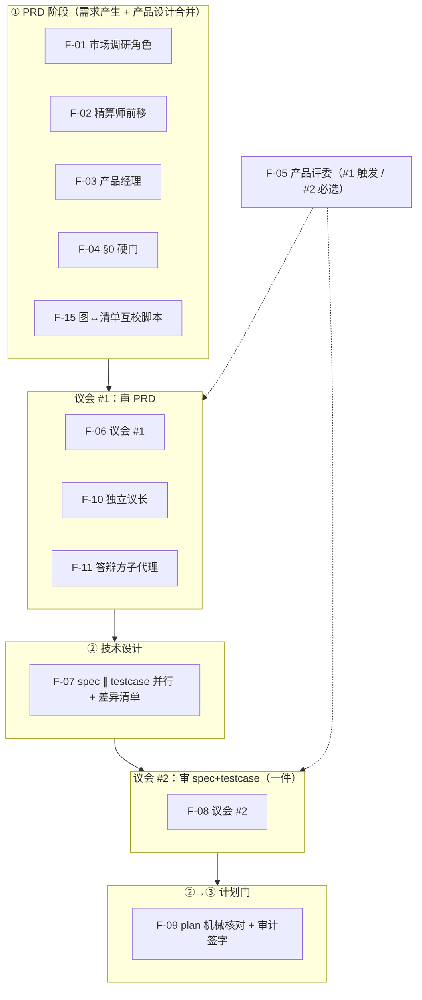

# 开发工作流主干：需求产生 → 产品交付（PRD）

> 状态：**待评审（未定稿）**｜本份 = 讨论结论的落盘快照 + 待确认清单，**不是定稿、不得送议会**
> 二轮状态（2026-10-24）：§11 的 23 条 D 全部有结论（5 条用户已裁 + 18 条 `[已决·代裁]`），`[待确认]` 为 0；**代裁项仍待你扫一遍**，扫完并通过 §0 硬门才谈送议会
> 事实基线（2026-10-24 补）：已拿原始对话记录 [20261024074213-drawing-parliament-flow-transcript.md](20261024074213-drawing-parliament-flow-transcript.md)（3192 行）逐条回核。下文凡写「记录 Lxxx」皆指该文件行号；记录里找不到「认 / 可以 / 就这么定」的，一律从 `[已确认]` 降为 `[待确认]`（本轮共降 9 处，见 §0.4）
> 目标：把 2026-10-23～10-24 连续讨论出的流程主干固定成可核对的文档；先补齐「我记不清 / 你尚未拍板」的部分，再谈拆 spec
> 落盘原因：此前全部结论只存在对话里，一次上下文压缩后就只剩摘要。这正是本仓「好记性不如烂笔头」要治的场景
> 本文不是 spec：只定「要发生什么」，不写字段、命令、文件结构；spec + testcase 另起，且按规矩同批由 `senior-sdet` 独立编写

## 0 裁决记录与事实基线（先读这一节）

### 0.1 三档标记（全文通用）

| 标记 | 含义 | 你该怎么处理 |
|---|---|---|
| `[已确认]` | 你明确说过「认 / 可以 / 就这么定」 | 抽查；有误直接推翻 |
| `[已决·代裁]` | **2026-10-24 本轮由我按各条「我的建议」栏代裁**（你没有逐条表态）；标在原来 `[待确认]` 的位置 | 逐条扫一遍；不同意的那条直接改回 `[待确认]` 并说明 |
| `[待确认]` | 我提议、你尚未表态 | 逐条划（见 §11） |
| `[FZ]` | 压缩后我只剩摘要，字面或数字不敢担保 | 你补原话或重述（见 §0.3） |

### 0.2 §0 硬门状态：**未通过（本文是草稿）**

按本仓 PRD 的 §0 硬门（四栏：市场 / 精算师 / 产品经理 / 用户，依据可核），本份**只填得出「产品经理（代拟）」与「用户（待裁定）」两栏**，市场调研与精算师签字都还没做。所以本文**不得送议会**——它的用途是给你补齐事实基线，不是过门。

| 栏位 | 提案 / 裁定 | 依据 | 状态 |
|---|---|---|---|
| 市场（20 年经验） | 未做外部同类流程方案调研 | —— | **缺** |
| 精算师 | 未出成本 / 收益初判；轮次取数已复算（7 轮精确合计 294 分钟，9 轮 ≥5 小时） | 记录 L1488–L1504；`.session/reviews/2026-10-22-093735-skill-eval-harness/progress.md` L24–L31 | **缺（签字）** |
| 产品经理（代拟） | 本文 §1–§10 | 2026-10-23～10-24 对话 | 草稿 |
| 用户 | 待裁定 | —— | 待 |

> 这份 PRD 自己没过 §0，恰好说明硬门是有牙齿的：起草人不能自己给自己签字。
> **2026-10-24 你的裁定（路径 A）**：允许 S1 带着「上游 PRD 未过 §0」送审，并把「补市场栏 + 精算师签字」改成 **S2 / S5 的入场条件**，不再让它阻塞 S1。理由：S1 的产物全是只读载体（skill / rule / 取证角色卡），返工成本低；卡住 S1 等 S2 / S5，等于主干骨架一直不落地。
> 由此两条硬约束：① **S1 送审说明必须显式写**「决策源 = 本 PRD，§0 未过门，18 条代裁待用户扫」；② 本 PRD 在 **S2 开工前**必须回到 §0 复核一次（市场依据 + 精算师签字），复核通过前 S2 / S5 不得开工。

### 0.3 模糊点补证结果（2026-10-24 用原始记录回核）

| 编号 | 原模糊点 | 记录原文 / 出处 | 现在 |
|---|---|---|---|
| FZ-01 | 「9 轮评审」的实际成本 | L1488–L1504 有逐轮账表，原句「有精确记录的 7 轮合计 294 分钟 ≈ 4.9 小时；加上无记录的两轮，9 轮 ≥ 5 小时」；另可用 `progress.md` L24–L31 复算（52+27+27+24+27+92+45＝294） | **已补**：294 分钟成立，≥5 小时有记录原句支撑；第 4 轮无精确记录（不单独外推） |
| FZ-02 | 被你否掉的「批量对齐」及理由 | L1086 我提「一批 3–5 个任务开一次会」；L1155 你否：「分批拆可能是由风险的，也就是功能的漂移……一下子把一批 spec 都拆好，后续更新之后 spec 的成本我认为会增加……应当保证当前开发功能的正确性，完整性」 | **已补**：对齐按功能 / 任务逐个做，不按批 |
| FZ-03 | 「三方认证」误读的原语境 | L1370 你问「议会审核，不就是三方认证吗？」；L1418 你纠正「……参与的都是自己人，这些怎么会是三方？但是议会中的人才是三方……独立于产品研发团队之外的三方视角」 | **已补**：你的「三方」＝独立第三方视角；内部对齐是自己人，不算认证 |
| FZ-04 | 被否的「三条收敛规则」是哪三条 | 内容在 L127–L131：①每席只交 PASS/FAIL + 至多 5 必修项 ②议长按族合并 ③级别冲突由审计凭两处证据裁定；L183 是**我**把它们判为「补丁思维」，且以「你说」开头——记录里找不到你的否决原话 | **已补**：三条内容找回；「被你否掉」系我误记，实为**我自行丢弃**（正文纠错） |
| FZ-05 | 你的定义性措辞 | L2411「对于文档完整和更新有很强精神洁癖」；L2650「他懂得什么时候做这件事情可以减少同步成本……他也是精明的当家人」 | **已补**：字面复原 |
| FZ-06 | S3「议会改造」的范围 | 记录 L3106–L3117（压缩后自述）列出：独立议长 + `host-duties` 拆分 + 两张矩阵 + 答辩方镜像 | **仍待确认**：构成全是我提的，你没逐项表态（归 D-05 / D-06 / D-08） |
| FZ-07 | 议长 A/B/C 你选哪档 | L1750 你原话「等等，为什么不是议长就是议长agent？即当裁判又当运动员？这样不好吧」；我随后给 A/B/C、推荐 A，你没选 | **已补方向**：你要的是独立议长；三档未拍板（归 D-08） |

### 0.4 本轮回核结论（2026-10-24）

| 结论 | 明细 |
|---|---|
| **保留 `[已确认]`（10 处）** | §3.1 三层角色；§4「合并前两段」（你提 L1588、我同意 L1593）；F-01（角色 + 联网工具）；F-02（L353）；F-03（L472）；F-04（L788「认」）；F-06；F-07（L1155「1.我认」）；F-08；F-11（L82） |
| **降为 `[待确认]`（9 处）** | §3.2 权力三分解；§3.3 三权分离总则；§4 五段骨架；§5 差异矩阵；§5「答辩方＝评委镜像」；§6 plan 机械门；§8.1 贝索斯命名 + 4 条判据；F-09；F-12 —— 记录里都只有我提议，你没有表态。**其中 §6 / F-09 已由本轮新裁定 ⑤ 升回 `[已确认]`，其余 7 处见下一行的代裁说明** |
| **本轮新裁定 `[已确认]`（2026-10-24，9 条）** | ① 交付单位术语改**功能块**（§4.1）；② 产品评委分工：#1 触发式 / #2 必选（§8.2）；③ 触发判定归审计、按功能点集合 diff 判，被告自判即违规（§8.2）；④ 一致性改**全量核对 + 对照表留痕**，不用抽查（§8.4）；⑤ plan 门＝脚本 + **审计本人读并签字**（§6）；⑥ 精算师**一票否决** + 三道保险 + 推翻须签字（§8.0）；⑦ 收敛规则：规则 2 复活、规则 1 不采纳、规则 3 改造为栏位化降级（§5.1）；⑧ 议长选 **A**，原「主持人」角色作废（§3.4）；⑨ 图分两层 + 每节点正文有解释（§8.4）。原裁决「产品评委 PRD 评审退场」（L917）由 ② 取代 |
| **`[FZ]` 7 条** | 全部补到原文（见 §0.3）；FZ-06 / FZ-07 的「范围 / 选档」已由本轮裁定收口（S3 见 §12；议长见 §3.4） |
| **D-01～D-23** | 23 条：D-01～D-22 产生于记录结束（L3141「你先写下来吧」）之后，D-23 产生于 2026-10-24 本轮；记录里没有逐条答复。其中 **5 条你已裁定**（D-01 / D-02 / D-03 / D-08 / D-11），**18 条由本轮代裁**（依据 = 各条「我的建议」栏 + 存量 docgen PRD 的结构件），逐条结论写进 §11 |
| **代裁的标记调整（2026-10-24）** | §3.2 / §3.3 / §4 / §5 / §5「答辩方＝评委镜像」/ §7 / §8.1（含其下「判据 2 分级」「攒批留痕」「人画 + 脚本互校」）/ §9 与 §10 的 F-12～F-16：由 `[待确认]` 改为 `[已决·代裁]`；`[待确认]` 现存 **0 处** |
| **正文纠错 1 条** | §8.1 原写「对应我的反问：贝索斯能把自己的文档维护好吗」——该问出自你的 L2910，已改为「你的反问」 |
| **正文纠错 2 条（2026-10-24 二轮，S1 spec 对齐时发现）** | ① §4 段表 4 格措辞与术语不统一：`任务↔testcase` → `功能块↔testcase`（与 §4.1 的术语改名对齐）、`测试绿` → `npm run check` 绿（本仓没有 build，这是唯一真实的验证命令）、`验收项全过` → `testcase 全过；负例与边界 ≥ 正例`（可判定）、`脚本 + 独立审计签字` → `脚本 + 审计本人读并签字`（与 §6 的裁定同口径）；② §12 的 S1 行改为「references **6 份**（5 段 + 计划门 1 份）+ `agents/evidence-reader.md`」——计划门有独立签字人与脚本判据，塞进段③的入口会被埋掉 |

**最该警惕的一条**：摘要是我自己写的。压缩后我**分不清「我提的」和「你认的」**。所以下面每条都带来源标记，凡标 `[待确认]` 的都不许当成事实往下推进。

## 1 要解决什么（问题陈述）

| # | 病根 | 证据（可核） |
|---|---|---|
| G1 | **自证结构**：主持人与答辩方同一个实例 | `skills/parliament/references/host-duties.md` 第 1 行「主持人与答辩方（主 agent 扮演）」 |
| G2 | **裁判权与程序权混在一手**：判对错虽在独立评委，但点名 / 定必带件 / 收卡 / 丢卡 / 计数 / 判结束 / 写记录仍在主 agent | `assembly-matrix.md` 硬规矩 2「主持人按矩阵出名单」+ `SKILL.md` 总流程 0–7 均由主持人执行 |
| G3 | **产品设计从未被独立第三方审过**：两次议会的评委席都无产品评委；且「产品评委在 PRD 评审退场」把它彻底关掉 | `submission-matrix.md` PRD 行＝读者+审计、spec 行＝前端/后端/审计；`reviewer-product.md` 仍在花名册但无处出场 |
| G4 | **轮次发散、成本高**：一次评审动辄 9 轮 | 记录 L1488–L1504：9 轮，其中 7 轮有精确账表、合计 294 分钟；9 轮 ≥5 小时。发散现象你在 L261 也点过（「昨天那次 9 轮的 review 有精算师在的话，是不是不会到 9 轮」） |

**根因收敛成一句**：**当事人自己划定边界**。G1/G2 是程序边界由当事人划，G3 是质量标准由当事人划。所以下面所有解法都指向同一总则（§3.3 三权分离）。

## 2 范围

**做**（本 PRD 要定下来的东西）：

- 五段主干与**两个**议会插点；
- 三次权力分解（裁判 / 程序 / 取证）与三权分离总则；
- plan 阶段降级为机械门（脚本 + 审计签字）；
- 产品线补强：产品经理角色、产品评委回归、图+表+清单三件套；
- **阅读取证角色（F-17）**：给长文（对话记录 / 评审账 / 规范）出「原文 + 行号」的可核事实摘要，供交接；
- 两个历史未闭环点的机械解法（分歧举证路由、漂移三分类）；
- 交付拆分 S1–S4（+ S5）。

**不做**：

- 具体字段、命令、文件结构（归 spec）；
- 存量 spec 的追溯补齐（存量不动，按「一个个升级」处理）；
- 代码施工与迁移；
- 本仓以外的项目形态（Electron 前端等）的流程差异。

## 3 核心模型

### 3.1 三层角色 `[已确认]`

你纠正过的原话（记录 L1668）：「主 agent 其实一直在啊，否则这些 subagent 怎么运转起来」；「用户，也就是我，也是一个跳出三界外的角色」。

| 层 | 是谁 | 在场方式 | 权力 |
|---|---|---|---|
| 第 0 层 委托人 | 用户 | 跳出行车道 | 给想法 / 终裁 / 打断（只有这三个动作） |
| 第 1 层 线程 | 主 agent | **全程在场**，形态随段变化 | 组织与执行；**议会内零程序权** |
| 第 2 层 阶段派发 | subagent | 派完即散 | 按角色卡出卡 / 答辩 / 核对 |

**关键区分**：主 agent 是「线程」不是「席位」。它**在场**，但在议会内**不占席位**——要么只当被告，要么只当议长，不兼。

### 3.2 权力三分解 `[已决·代裁]`

| 权力 | 内容 | 现在在谁手里 | 目标 |
|---|---|---|---|
| **裁判权** | 判对错、出卡 | 独立评委（已解决） | 不动 |
| **程序权** | 点名 / 定必带件 / 收卡 / 丢卡压卡 / 计数 / 判结束 / 写记录 | 主 agent（**未解决**） | 交给独立议长；主 agent 只保留「按矩阵机械派 agent」 |
| **取证权** | 跑命令、出机器证据 | **无人能独立行使**（见 §9） | 给到需要证据的角色 |

程序权为什么必须独立：**程序权不需要裁判权也能操纵结果**——压一张卡、少点一个评委、把「不通过」记成「通过」，都不需要判对错。

> **回核结果（降级原因）**：你的原话（L1750）只提出「议长不能既当裁判又当运动员」——「程序权必须独立」这半段来自你；但「裁判 / 程序 / 取证」三分表、以及「取证权给到需要证据的角色」都是我在记录里提的，你没有表态，故整节降为 `[待确认]`。
> **2026-10-24 代裁**：三分表采纳。程序权 → `speaker`（S3，连带 `producer` 档）；取证权 → `producer` 档（S5，见 §9 与 D-14 的平台核对结论）。

### 3.3 三权分离总则 `[已决·代裁]`

| 权 | 谁有 | 不许做什么 |
|---|---|---|
| **申报权** | 做事的人（主 agent / sdet / 作者） | 只能陈述事实，**不能自行定性**（不能自己宣布「这是细节偏差」） |
| **定性权** | 独立于做事的人（sdet 对漂移、评委对缺陷） | 不得参与被定性那件事的生产 |
| **核对权** | 第三方（审计 / 侦探） | 不得只核结论，须比对原始证据（git diff、命令输出） |

这条是总则，§7 的两个解法都是它的具体套用。

> **回核结果（降级原因）**：这条总则是我在记录里提的；提出后你的下一句就转去问「我是不是这一次有几个新增 agent 和 skill？」（L2170），没有表态。
> **2026-10-24 代裁**：总则采纳，且它是 §7 两个解法的总纲。S1 只写条文与每段的「谁申报 / 谁定性 / 谁核对」对照，不造机制（机制在 S3 的议长与 S5 的工具档位）。

### 3.4 议长：独立 agent（选 A）`[已确认]`

**你的原话（L1750）**：「为什么不是议长就是议长agent？即当裁判又当运动员？这样不好吧」。L1780–L1786 给了 A/B/C 三档，2026-10-24 定 **A**（A＝新增独立议长；B＝主 agent 当议长但七项全机械判；C＝主 agent 执行 + 独立监票）。

| 项 | 定案 |
|---|---|
| 议长是谁 | 新增独立 agent `speaker`，由主 agent 按矩阵机械派出 |
| 「主持人」角色 | **作废**。仓库里从来没有主持人 agent，它是主 agent 的兼职（`host-duties.md` 第 1 行「主持人与答辩方（主 agent 扮演）」） |
| 职责二分 | 程序类（点名 / 定必带件 / 收卡 / 丢卡压卡 / 计数 / 判结束 / 写记录）→ `speaker-duties.md`；答辩类（架构师 7 方向 / 研发编制 / 答辩纪律）→ `respondent-duties.md` |
| 主 agent 在议会内 | **零程序权**，只保留「读两张矩阵、照表起 agent」；不得增删席位、不得改必带件 |
| 跨轮状态 | 议长读 `progress.md` 接上，不依赖主 agent 的记忆 |
| 连带依赖 | 议长要写记录 → 需要写权；要跑计数 → 需要命令执行权。两者都要等 §9 的 `producer` 档落地，**A 不能先于工具档位单独做** |

## 4 主干五段与两个议会插点 `[已决·代裁]`



| 段 | 出口判据 | 谁签 | 议会 |
|---|---|---|---|
| ① PRD（需求产生 + 产品设计） | §0 四栏齐 + 依据可核；功能点清单与流程图双向一一对应 | 产品经理 + 用户；审计核 §0 | **议会 #1** |
| ② 技术设计 | spec + testcase 一件齐；差异清单留痕；内部对齐零未决 | 主 agent + sdet | **议会 #2** |
| ②→③ 计划门 | 功能点全覆盖 / 依赖无环 / 功能块↔testcase 一一映射 | 脚本 + **审计本人读并签字** | **无议会** |
| ③ 技术实现 | 施工完成、`npm run check` 绿 | 开发 | 无 |
| ④ 质量保证 | testcase 全过；负例与边界条数 ≥ 正例 | sdet | 无 |
| ⑤ 产品交付 | 交付审计（含数字签字项） | 审计 | 无 |

**为什么合并前两段** `[已确认]`（你提 L1588，我同意 L1593）：需求产生与产品设计产出的都是同一份 PRD，分两段＝两处维护＝必然漂移。

> **回核结果（本节降级原因）**：「合并前两段」是你提的，可当结论；但「五段」这个切法与「议会只插 2 次」是我画的（记录 L1595 起写成 5 段，当时 plan 插点还在，后来被我降级）。你在 L1913 说的是「**假设**待确认全都认，你现在用流程图的方式画一下」——假设语气不是拍板，所以本节骨架仍 `[待确认]`。
> **2026-10-24 代裁**：五段切法与「议会只插 2 次」采纳（D-04 / D-18 同批裁定）。计划门保留在 ②→③ 处且**不设议会**（§6）。

### 4.1 交付单位：功能块 `[已确认]`

「任务」这个词在同一仓里有三种用法（plan 里的执行步骤、待办项、这里的交付单位），读者会串。2026-10-24 定为**功能块**。

> **功能块** = 一个功能完整、可独立验收、AI 在 1～1.5 小时内能做完的交付单位。
> 它是 spec 与 testcase 的最小单位：一个功能块产一份 spec + 一份 testcase。
> PRD 里每个功能点默认就是一个功能块；只有功能点本身大到一块做不完时才拆成多块，且必须写明「为什么拆、拆完怎么合起来验收」。
> **拆是滚动的**：做完一块再拆下一块，不提前批量拆——因为第一块完成时通常出现功能漂移（补充或删减），提前拆好的一批 spec 会成片返工（你 L1158 的原话理由）。

| 不许 | 为什么 |
|---|---|
| 按技术层切（前端一层 / 后端一层各算一块） | 切完没有一块能独立验收 |
| 为凑 1 小时硬拆 | 破坏功能完整性；完整性优先于时间（L1158） |
| 提前把一批功能块全拆成 spec | 一次漂移带来成片返工 |

## 5 两次议会的差异矩阵 `[已决·代裁]`

| 维度 | 议会 #1 | 议会 #2 |
|---|---|---|
| 审什么 | PRD | spec + testcase（**一件**） |
| 必带件 | PRD + 索引（无 testcase） | spec + testcase（硬门）+ 差异清单 |
| 主责评委 | 读者 + 审计 + **产品评委（触发式）** | 前端 / 后端 / 审计 + 测试主审 + **产品评委（必选）** |
| 答辩方 | 产品经理（代表市场 + 产品 + 用户） | leader + 主 agent + sdet + respondent-dev |
| 主 agent 身份 | **完全不在议会内** | **被告**（零程序权才真正受考验） |
| 通过后 | → ② 技术设计 | → plan 机械门 |

**答辩方 = 评委席专业面的镜像**（硬判据）`[已决·代裁]`：评委问到的专业面，答辩方必须有人能接；否则只能全盘承认或空谈。据此，#1 若点技术评委，#1 也必须配技术答辩方——这就是 D-04 要决策的取舍。（这条判据是我提的；你在 L2338 只追问了「议会#2 答辩方…其他开发呢」，没表态）

> **2026-10-24 代裁**：镜像判据采纳；**D-04 走方案 A**——#1 不额外点技术评委（改 `submission-matrix` 的 PRD 行），理由是镜像判据会强制扩编答辩方，而技术面在 #2 已有前端 / 后端 / 测试三席覆盖，#1 再点等于同一条技术问题审两遍。这同时给了 §5 矩阵表「主责评委」一栏的定稿依据。

**FZ-03 补证（内部对齐 ≠ 第三方认证）**：你 L1418 的原话——「需求产生到产品设计和技术设计，这里面都是研发团队内部目标对齐、价值澄清，参与的都是自己人，这些怎么会是三方？议会中的人才是三方……独立于产品研发团队之外的三方视角」。所以独立第三方审点只有两次议会；内部对齐不产生「认证」。

### 5.1 收敛规则：一不采纳、一复活、一改造 `[已确认]`

| 原规则（L127–L131） | 处置 | 落成什么 |
|---|---|---|
| 每席最多 5 个必修项 | **不采纳** | ——（已有「零必修才停」的停机判据，且与按族合并功能重叠） |
| 议长按族合并 | **复活** | 议长**一人**合并（语义判断只能一个裁决点）；产出**族映射表**：原卡号 → 族号 → 一句合并理由 |
| 级别冲突由审计裁定 | **改造** | 不做级别裁定，改**栏位化降级**（见下） |

**族映射表的守恒核对（侦探做，全是数数，不需要懂技术）**：

1. 原卡总数 = 映射表行数（少一行 = 丢卡）；
2. 每个族至少挂 1 张原卡（空族 = 凭空造族）；
3. 进答辩的族数 + 有理由关闭的族数 = 总族数（对不上 = 压卡）。

**级别栏位化（替代「审计裁级别」）**：

> P0 卡必须写一栏「不改会导致的具体后果」，且该栏含可指涉的东西（文件 + 行号 / 用例编号 / 用户场景）。缺栏 → 自动降 P2。双方都写了具体后果、级别却不同 → 取 P0，并在报告里并列双方依据。

为什么不能让审计裁：级别高低是技术判断，让审计裁 = 让记账的人做技术裁判，与审计角色卡「不裁决技术分歧」冲突（见 `tools/docgen/components/sharedBlocks.mjs` 的审计铁律）。栏位化之后没有任何人做裁判：「有没有写、有没有指涉」是字段形态核对，审计本职可做。

## 6 plan 为什么不设议会 `[已确认]`

你的质询（L1828）：「plan 需要议会审核意义是什么？」论证如下：

| plan 可能的缺陷 | 执行时会不会自愈 | 能不能机器查 |
|---|---|---|
| 顺序错 / 依赖错 | 会——第一步就卡住，当场改 | 能（依赖无环） |
| 粒度不对 | 会——做不动就拆 | 半能 |
| **覆盖缺口**（某个功能点没有任务） | **不会——静默漏过，做到「完成」才发现** | **能（纯集合比对）** |

前两类是「会当场自愈的错」，用议会去抓＝高成本抓低价值；第三类不可自愈，但它是**集合比对**，脚本比人准。于是：

- **0 评委席**（plan 交给审计，不设议会）；
- 门 = 脚本（功能点全覆盖 / 依赖无环 / 功能块↔testcase 一一映射）+ **审计本人读 plan 并签字**；
- 签字必须带证据：读了哪几节、核了哪几项、取数命令与输出（只签字不读 = 橡皮章，按不通过处理）；
- plan 里发现 spec 未定义的东西 → **回流 spec 重审**，不许在 plan 阶段临时补全。

> **2026-10-24 你的裁定**：plan 交给审计。这一句同时收口了两个旧口径——记录 L1552 我建议「1 席审计 + 机器核对」，PRD 后来写成「0 评委」；现按「0 评委席 + 1 席审计且必须真读」执行。
> **连带依赖**：审计要读 plan、要跑三条核对，就必需执行工具——同样等 §9 的 `producer` 档，不能先落门再补工具。

## 7 两个历史未闭环点的解法 `[已决·代裁]`

两个问题的同一个根：**边界由当事人自己划**。所以都用 §3.3 三权分离套。

> **2026-10-24 代裁**：两处解法（分歧举证路由 / 漂移三分类）采纳；落点分别在 S2（内部对齐）与 S4（技术设计段的漂移定性），S1 不施工，只在主干判据 rule 里写「申报 / 定性 / 核对」三权归属。

### 7.1 分歧举证路由（内部对齐失败之后）

| 规则 | 内容 |
|---|---|
| 有效分歧门槛 | 必须指名「被推翻的是**哪一栏结论**」：市场 / 精算师 / 产品经理 / 证据 / 用户裁定 |
| 指不出来 | 分歧**直接关闭**并记录，**不进入回退流程** |
| 用户豁免 | 你说「我不想要」本身即有效依据，无需指栏 |
| 收敛上限 | 同一分歧点回退 **2 次**仍不收敛 → 直接升级用户终裁，停止循环 |
| 谁记录 / 谁路由 | 审计（记录分歧与机械路由结果） |

理由：不指栏的分歧是「我不喜欢」，无法定位到需求变更点，回退回去也只能再吵一遍。

### 7.2 漂移三分类（需求漂移的定性）

| 类型 | 机械判据 | 回退路径 |
|---|---|---|
| **细节偏差** | 功能点集合不变，且 testcase 判据不变 | 记入 spec 修订，不回流 |
| **行为偏差** | 功能点集合不变，但 testcase 判据需改 | 回 PRD 补定义 |
| **功能增删** | 功能点集合发生变化 | 回 PRD，重签 §0 |

| 权 | 谁 | 干什么 |
|---|---|---|
| 申报 | 主 agent | 只报「变了什么」，不定性 |
| 定性 | **sdet**（独立于改动） | 按上表判类型 |
| 核对 | 审计 | 比对 git diff，抽查漏报 / 错报 |

## 8 产品线的补强

### 8.0 精算师：一票否决 + 三道保险 `[已确认]`

**你的原话（L916）**：「最后一定要通过精算师的同意，精算师不能过于刁难和畏畏缩缩，要站在事实层面」。这句给的是**否决权**，不是建议权；同时要治两个病：过于刁难 / 畏畏缩缩。

| # | 保险 | 防的是 |
|---|---|---|
| 1 | **否决必须带事实**：数字 + 取数来源，或外部依据（产品名 / 链接）；带「我觉得」的否决无效 | 畏畏缩缩——说不出事实就不敢否，或乱否 |
| 2 | **否决必须给替代**：不做那做什么，或怎么做才值得；只否不给路 = 无效否决 | 过于刁难——否完就完，项目死 |
| 3 | **同一理由不得否决第二次**（除非带新事实） | 反复纠缠 |

**和你终裁权的关系**：精算师否决 → 你可以推翻，但推翻必须签字留痕，固定一句：

> 「已知此项不划算（精算师否决依据：<…>），仍决定做，理由是 <…>」——用户签署，日期。

为什么必须留这一句：不留就有两个极端——精算师一否等于你必须服从（他成了老板），或你想推翻就推翻（他成摆设）。

**出场两次**：初判（不值得就不写 PRD）+ 复核（防写 PRD 时数字被悄悄调好看）。复核若推翻自己初判，必须点出初判遗漏了哪条事实。

### 8.1 产品经理：贝索斯式的当家人 `[已决·代裁]`

你追加的设定（L2411）：画流程图高手、mermaid/plantuml 熟练、图文并茂讲清业务流程、对文档完整与更新有很强精神洁癖；但（L2650）「他懂得什么时候做可以减少同步成本……也是精明的当家人」。

对应**你的**反问（L2910）：**贝索斯可以把自己的文档维护好吗？** 答案是——不需要靠自觉。当家人的可靠性来自「底线不可协商」，不来自自觉；只靠自觉，他一定会省到不该省的地方。

洁癖工程化成 4 条机械判据（不写形容词）：

| # | 判据 | 为什么能机械判 |
|---|---|---|
| 1 | 功能点 ↔ 图节点**双向一一对应**（清单→图 无漏、图→清单 无孤儿） | 集合比对 |
| 2 | 图 / 表 / 清单**同批更新** | 见下方分级 |
| 3 | **不留过期图** | 判据 1 成立时，过期图必然暴露为孤儿节点或缺失节点 |
| 4 | 只收 **mermaid / plantuml 源码**，导出 png/svg 不作唯一表达 | 源码可 diff、可机械核 |

**判据 2 分级（关键修正，我曾写成「每次改动立即同步」被你纠正）** `[已决·代裁]`：

| 变化类型 | 节奏 |
|---|---|
| **结构变化**（单向门：功能点增删、流程改道） | **必须同批** |
| **语义变化**（双向门：措辞、举例） | 可攒批 |
| **送审门** | 一律收敛（不允许带着待同步项送议会） |

**先减同步面积，再谈节奏**（根因：重复表达越多，任何改动要动的地方越多）：

| 手段 | 做法 |
|---|---|
| 不重复表达 | 清单＝是什么 / 图＝流程 / 表＝步骤，三者不重叠 |
| 节点用 ID + 短名 | `F-01 市场调研角色`，不抄整段描述 |
| 分区 | §0–§1 低频区（签字类）、§4 高频区（功能点） |
| 清单加列 | 「进流程图：是 / 否」——不画图的项不进图，减少无谓对应 |

**攒批必须留痕**（新增输出物「同步决策记录表」）`[已决·代裁]`：4 列＝攒了什么 / 攒到哪 / 为什么不划算 / 实际结算。

**图与清单的关系：人画 + 脚本互校，不派生** `[已决·代裁]`。图由清单生成会失去业务语气；文字由图生成不可行。脚本只做核对，不做生成。

> **回核结果（降级原因）**：「很强精神洁癖」「精明的当家人」是你的原话（L2411 / L2650），可当事实；但「贝索斯」这个原型命名、以及 4 条机械判据与三档同步节奏，都是我提的，你没有表态。
> **2026-10-24 代裁**：命名与 4 条判据采纳（1/3/4 已可机械核；判据 2 按三档分级）。同步决策记录表与「人画 + 脚本互校」一并采纳——D-09 / D-10 / D-12 / D-13 在此收口，`F-15` 脚本归 S2/S4。

### 8.2 产品评委：乔布斯式的偏执狂，分工回场 `[已确认]`

你的关键一击（L2910）：「**乔布斯会出现在评审会上吗？因为现在议会里面只要有产品经理的地方就没有产品评审**」。

**先修正定性**：这不是「你前后相反」。L917 你明确说过「嗯，产品评委可以退场」，我当时落账「已确认」（L923 / L1025）。那是**已裁决**；L2910 是你在看到后果后提出的**新事实**——答辩方是当事人，替代不了第三方。按「重提已裁决需求须带新事实、直接升级用户终裁」，这条走你的终裁，不是重开讨论。

核实结果：

| 议会 | 产品评委在不在 | 依据 |
|---|---|---|
| #1 审 PRD（普通） | 不在（读者 + 审计） | `submission-matrix.md` PRD 行 |
| #1 审 PRD（技术 PRD） | 名义上在（+ 产品） | 同上 |
| #1 审 PRD（实际） | 不在——被原「退场」裁决覆盖 | L917 / L923 / L1025 |
| #2 审 spec | **完全没有席位**（前端 / 后端 / 审计 + 测试） | `submission-matrix.md` spec 行 |

**2026-10-24 定：不撤销也不全开，按分工回场。**

| 议会 | 产品评委 | 判什么 |
|---|---|---|
| #1 审 PRD | **触发式**：只在涉及产品形态变更 / 功能删减时点名 | 「这里说不通」：PRD 自相矛盾、用户旅程断点、验收不可判定 |
| #2 审 spec | **必选** | 「翻译丢了」：spec 有没有偏离 PRD 的产品意图 |

**四个配套判据（缺一就退化成盖章）**：

1. **触发判定归审计**，按功能点集合 diff 判；**产品经理自判即违规**——他就是被告，自判等于自证。
2. **降级门槛用可数口径**：`#1 产品评委被点名 ≥2 次，且这 2 次进入最终报告的硬伤卡合计 0 张`。同时设**复活线**：一旦 #2 抓到「产品意图偏离」且该偏离本可在 PRD 阶段发现，立即恢复 #1 必选。
3. **「两个独立实例」是施工前置，不是质量门槛**：产品经理与产品评委必须是两个不同实例（现在 `agents/` 连产品经理卡都还没有，见 F-03）。这条挂在 S2，不挂在准入判据里。
4. **一致性不归它**：图 / 表 / 清单是否一致归脚本（F-15）；脚本落地前归审计全量核对（§8.4）。产品评委只判上表那两类语义问题。

**精算师意见（2026-10-24 独立评审）**：「条件保留」——现在两处都保留；上面 1–3 满足后再让 #1 转触发式。它同时算清一笔账：**加一席不增加墙钟**（席位并行），成本主项是轮数不是席位数，「砍席位省钱」砍的是零头。它同时指出一个容易搞错的点：#2 的产品评委查的不是理念重复，是**翻译丢失**。

**产品评委的边界（只出硬伤卡）**：

| 出 | 不出 |
|---|---|
| 自相矛盾 | 审美偏好（「我希望是另一种交互」） |
| 逻辑悖论 | 需求合理性（§0 已裁决，除非携带新事实走升级通道） |
| 功能遗漏 | 实现方案（归 #2） |
| 验收不可判定 | |
| **spec 偏离 PRD 产品意图**（仅 #2） | 图 / 表 / 清单是否一致（归脚本或审计全量核对） |

**原型分工一句话**：**议会里需要偏执狂，流程里需要当家人。把偏执狂放进流程，流程会被拖死；把当家人放进议会，门会漏。**

### 8.3 三件套与既有先例

`skills/prd-to-specs/references/conventions.md` 第 35 行已有「mermaid 时序图 + 每阶段步骤表」的成对约定——产品经理的「图文并茂」**沿用这条**，不另造规范。

PRD §4 拟改名「业务流程与功能点（图 + 表 + 清单）」`[已决·代裁]`（D-21；落 S2 的 PRD 模板）。

**存量 docgen PRD 的可借鉴点（初稿，2026-10-24）**

| 借鉴 | 出处 | 用到哪 |
|---|---|---|
| 裁决表「出处」栏分级（用户 / 主持人决定 / 授权自定） | `docs/prd/docgen-index.md` §2 | 本份 §0.1 的 `[已决·代裁]` 就是这么来的：谁的裁定一眼可查 |
| 验收表固定四列 + 预期写机械可判句 | `docs/prd/20261019093443-docgen-agent-generation.md` §5 | S1–S5 每份 spec 的验收节照此写「exit 0 / 逐字节一致」，不写「功能正常」 |
| 结论表回指证据编号（挂不上＝不算成立） | 同上 §6.6 | 本份 §0.4 的回核表；S1 spec 的失败面表 |
| 计数断言从单一源派生（不硬编码 N/N） | 同上 §7-6（`baseline N/N`） | S1 加 `reader` 后 baseline 必须 36/36，且从 `baseline.mjs` 派生 |
| 过门判据二元化 + 例外带编号 | `docs/prd/docgen-index.md` §4 | 议会通过判据（P0 = 0 且必修 ≤ 5） |

**不借鉴**：逐文件双哈希 golden 锁定（一次性搬家适用，主干要持续演进）；退出码五档映射（本流程不产 CLI）；spike 目录故障注入（实现级，挤掉裁决）；`gen-agents` 双原子删时序（无待退役脚本）。

### 8.4 图的可读性：颗粒度 + 全量互校 `[已确认]`

你在 2026-10-24 的要求：**在意「能看得懂的图和文字」**，产品经理画图时必须注意颗粒度与理解成本。工程化成两条：

| # | 判据 | 怎么核 |
|---|---|---|
| 1 | **图分两层**：主干图只画段与议会插点（≤10 节点）；段内图每段一张，只画角色进出与步骤 | 主干图节点数可数；出现「一张图想画完所有东西」即不通过 |
| 2 | **每个节点正文有解释**：任意节点，正文里必须有一段话解释它；找不到解释的节点 = 画多了 | 逐节点对照，可人工全量核 |

**脚本落地前，一致性不抽查，做全量**：

> 图 / 表 / 清单一致性由审计**全量**核对：逐条填对照表（功能点 ID / 图节点 ID / 表行 ID），三列缺一即不通过；对照表随 PRD 同批落盘，作为送审件的一部分。
> 脚本上线后，全量核对的活由脚本接（进 `npm run check`），审计只核 0 findings 与例外项，不再手工逐条。

为什么不用抽查：抽查漏掉的那部分永远不知道漏了；而这里量小（十几个节点、三张表），全量做得到。**如果哪天量大到人工做不动，说明脚本该上线了，不是说明可以抽查。**

## 9 工具档位缺口 `[已决·代裁]`（上一轮新发现）

**现状**：`tools/docgen/components/patternRegistry.mjs` 只有两档——`readOnly`（Read/Glob/Grep）与 `sdet`（+Write/Edit）。14 席实际取值：13 席 readOnly，仅 `senior-sdet` 多 Write/Edit。**全仓零命令执行能力**。

后果清单：

| 角色 | 他的职责要求 | 现在能不能做到 |
|---|---|---|
| 审计 | 「两表必由本人完成，证据栏空＝不通过」 | **不能**——跑不了 `npm run check` / `git diff` / `time.mjs`，只能等主 agent 贴给他 |
| 精算师 | 出成本 / 收益初判（要取数） | **不能**——只能引用别人给的数 |
| 产品经理 | 用脚本互校图与清单 | **不能**——只能眼看 |
| 产品经理 | 写 PRD | **不能**——readOnly 无 Write |

**这是「取证权」整条线的断裂**，不是产品经理一个人的缺口。取证也得由被告代跑，三权分离在取证层就塌了。

拟议：

| 档位 | 工具 | 给谁 |
|---|---|---|
| `research` | readOnly + WebSearch + WebFetch | 仅市场同学 |
| `producer` | readOnly + Write + Edit + RunCommand（**白名单**） | 产品经理、审计（按需）、sdet |

`producer` 白名单只放只读 / 校验类：`node scripts/check-prd-graph.mjs *`、`git diff|show|log *`、`node skills/review-log/scripts/time.mjs`；禁 `git commit|push|checkout`、`rm`、任意写操作。

**两个前提我不凭猜**：

1. 本平台子代理的 `tools:` 是否支持逐条白名单？若只能整档给命令工具，「禁写操作」就退化成靠角色卡自觉——那就不合格，得改成只给脚本入口。
2. 平台命令工具确切名（本仓规则里出现过 `RunCommand`，见 `rules/import-guard.md` L55），需对齐后再写 frontmatter。

### 9.1 平台能力核对结果（2026-10-24 实查）

| 查了什么 | 怎么查的（可复核） | 结果 |
|---|---|---|
| frontmatter 的 `tools` 能表达什么 | 读全部 14 张卡 + 模板 `skills/parliament/assets/agent-template.md` L4 + `tools/docgen/templates/agent.md.tpl` L4 | 值是**逗号分隔的工具名清单**，没有任何按命令 / 参数限定的语法位 |
| 生成器数据模型 | `tools/docgen/components/patternRegistry.mjs` L14（两档，值为工具名数组）、`renderAgent.mjs` L27（只做 `tools.join(', ')`） | 只能产出工具名清单 |
| 校验器粒度 | `validateAgentData.mjs` L40–43（`ToolsViolation`：tools 集合与允许集**恰等**） | 校验粒度也是工具名 |
| 命令工具名 | 本 agent 运行时工具清单；`rules/import-guard.md` L55 | `RunCommand` ✔（前提 2 已解） |

**结论（前提 1）**：**「RunCommand 按条白名单」在本仓可控范围内落不了地**——平台没有参数级授权位，仓内也没有任何绕过的表达方式。

**D-14 处置（代裁）**：

1. `producer` 档 = `readOnly + Write + Edit + RunCommand`，**整档授予**，不假装有白名单；
2. 「禁写」从「平台预防」降级为**过程可检测**：角色卡列允许命令清单（只读 / 校验类：`node scripts/check-prd-graph.mjs *`、`git status|diff|show|log *`、`node skills/review-log/scripts/time.mjs`）；每轮议会收尾由**侦探**核对 `git status --porcelain` 与轮初快照，出现非预期写操作即出 P0 卡；
3. 这一条与 `docs/prd/docgen-index.md` §5 的 N4（「平台提供不可绕过只读」才做权限锁）同口径，不自造权限层；
4. **认输判据**：平台一旦支持参数级白名单（或提供不可绕过的只读），第 2 条的检测门撤掉，改回平台预防——那才是等价物，现在的检测只是替代品。

**风险**：给写权必须同时钉住 §0——产品经理一改功能点集合就是「功能增删」类漂移，须回 PRD 重签 §0，不能自己改完就算（D-22）。

## 10 功能点清单

> 本表是本文的功能点权威清单。图里只画「进流程图＝是」的项（D-12 待确认的「进流程图」列，本表已先行采用）。

| ID | 功能点 | 所属段 | 进流程图 | 来源 |
|---|---|---|---|---|
| F-01 | 市场调研角色（新建，`research` 档，WebSearch + WebFetch） | ① | 是 | `[已确认]`（角色 + 联网是你提，L353 / L788；`research` 档名归 D-15） |
| F-02 | 精算师前移至 PRD 阶段 + 评审阶段自我复核（纳入侦探核对项） | ① | 是 | `[已确认]` |
| F-03 | 产品经理角色（代表市场 + 产品 + 用户，写 PRD、画图、提 §0 三方提案） | ① | 是 | `[已确认]` |
| F-04 | §0 需求裁决记录硬门（四栏齐 + 依据可核），审计核对 | ① | 是 | `[已确认]` |
| F-05 | 产品评委分工回场：**#1 触发式**（审计按功能点 diff 判）/ **#2 必选**；只出硬伤卡 | 跨 | 是（虚线） | `[已确认]`（§8.2） |
| F-06 | 议会 #1 插点（审 PRD） | ①→② | 是 | `[已确认]` |
| F-07 | 技术设计：spec ∥ testcase 并行独立产出 + 差异清单留痕 | ② | 是 | `[已确认]` |
| F-08 | 议会 #2 插点（spec + testcase 一件） | ②→③ | 是 | `[已确认]` |
| F-09 | plan 机械核对门（脚本 + **审计本人读并签字**）+ 漏项回流 spec | ②→③ | 是 | `[已确认]`（§6） |
| F-10 | 独立议长（`speaker`），主 agent 议会内零程序权；主持人角色作废 | 跨 | 是 | `[已确认]` D-08 → A（§3.4） |
| F-11 | 答辩方全部由独立子代理承担 + 「评委席镜像」判据 | 跨 | 是 | `[已确认]`（L82 你提；镜像判据 `[已决·代裁]`，见 §5） |
| F-12 | 三权分离总则（申报 / 定性 / 核对） | 横切 | 否 | `[已决·代裁]`（§3.3） |
| F-13 | 漂移三分类 + sdet 定性 + 审计比对 diff | 横切 | 否 | `[已决·代裁]`（§7.2） |
| F-14 | 分歧举证路由（指栏 / 豁免 / 2 次上限） | ①内部 | 否 | `[已决·代裁]`（§7.1） |
| F-15 | `scripts/check-prd-graph.mjs` 图↔清单互校 + 并入 `npm run check` | ① | 是 | `[已决·代裁]`（D-11 已裁 + D-12 / D-13 收口） |
| F-16 | 工具档位 `producer` / `research` | 横切 | 否 | `[已决·代裁]`（§9；`producer` 白名单前提不成立，见 §9.1 处置） |
| F-17 | 阅读取证角色（新增 agent，定名 `evidence-reader`；`Read / Glob / Grep`）：通读长文（对话记录 / 评审账 / 规范），**只交「原文 + 行号 + 出处」的事实摘要**，供主 agent 交接；**不出观点、不出问题卡、不参与评审** | 横切 | 否 | `[已确认]`（你本轮要求新增；名称 `evidence-reader`、形态 `[已决·代裁]`——定名理由见 S1 spec §6.1：`agents/reviewer-reader.md` 已存在，裸 `reader` 会让派单出错） |
| F-18 | 收敛机制：议长一人按族合并 + 族映射表（原卡号 → 族号 → 理由）+ 侦探核三条守恒 | 跨 | 否 | `[已确认]`（§5.1） |
| F-19 | 级别栏位化降级：P0 必须写「不改会导致的具体后果 + 可指涉物」，缺栏自动降 P2 | 跨 | 否 | `[已确认]`（§5.1） |
| F-20 | 交付单位术语「功能块」+ 滚动拆、不批量拆 | 横切 | 否 | `[已确认]`（§4.1） |
| F-21 | 精算师一票否决 + 三道保险 + 用户推翻须签字留痕 | ① | 否 | `[已确认]`（§8.0） |
| F-22 | 图的可读性双判据（分两层 / 每节点正文有解释）+ 一致性全量核对替代抽查 | ① | 否 | `[已确认]`（§8.4） |

## 11 待确认清单（逐条划）

> **本轮已用原始记录回核（2026-10-24）**：这 23 条里，D-01～D-22 产生于记录结束（L3141「你先写下来吧」）之后，D-23 产生于 2026-10-24 本轮；记录里**没有逐条答复**。下表「你答」只写记录里能剖出的方向性依据；写「待」＝记录里没有任何依据。
> **2026-10-24 已决 5 条**：D-01、D-02、D-03、D-08、D-11（你裁定）。**其余 18 条由本轮代裁**（`[已决·代裁]`，理由见各行）——23 条现已全部有结论，`[待确认]` 为 0；不同意的那条改回 `[待确认]` 即可。

| ID | 待确认项 | 我的建议 | 你答（记录回核） |
|---|---|---|---|
| D-01 | 原裁决「产品评委 PRD 评审退场」如何处置 | 分工回场，不撤销也不全开 | **已决（2026-10-24）**：L917 是原裁决，L2910 带新事实（当事人 ≠ 第三方）升级终裁；定为 #1 触发式 / #2 必选（§8.2） |
| D-02 | 产品评委只出硬伤卡 | 采纳 | **已决**：收窄为两类判据（#1「说不通」/ #2「翻译丢了」），一致性划归脚本或审计全量核对（§8.2 / §8.4） |
| D-03 | `submission-matrix` 两行怎么加产品评委 | 拆 a / b | **已决**：D-03a＝PRD 行加「产品评委（触发式）」；D-03b＝spec 行加「产品评委（必选）」（§8.2） |
| D-04 | 议会 #1 走方案 A：技术 PRD 不额外点技术评委（改矩阵），避免答辩方被迫扩编 | 走 A | **已决·代裁**：走 A。理由：镜像判据（§5）会强制扩编答辩方，而 #1 的答辩方只有产品经理一人，接不住技术面；技术细节在 #2 已有前端 / 后端 / 测试三席，同一条技术问题不该审两遍 |
| D-05 | 议会 #2 答辩方 = leader + 主 agent + sdet + respondent-dev | 采纳 | **已决·代裁**：采纳。方向来自你 L2338「其他开发呢」，具体名单是我补的；sdet 必在（他是 testcase 作者，必须能答「为什么这么测」） |
| D-06 | `respondent-dev` 用 **1 个换背景**而非 3 个独立 | 用 1 个（本仓形态） | **已决·代裁**：用 1 个。理由：单仓单团队，多个实例会先内耗「谁代表开发」；镜像判据只要求「接得住」。**留观**：S3 若出现「同一问题两轮立场不一致」，改成 3 个独立 |
| D-07 | `assembly-matrix` 纯文档仓库行：精算师升必选；测试在 #2 升必选 | 都升 | **已决·代裁**：都升。「精算师出场机会太少」（L261）与「更早接入」（L353）是你提的，升档是它的落地 |
| D-08 | 议长改为独立 `speaker` agent（A），主 agent 零程序权 | 走 A | **已决（2026-10-24）**：选 A，主持人角色作废，职责二分（§3.4）。连带依赖 `producer` 档（写权 + 命令执行） |
| D-09 | 同步判据分级：结构变化同批 / 语义变化攒批 / 送审门收敛 | 采纳 | **已决·代裁**：采纳三档。依据是你 L2650「懂得什么时候做可以减少同步成本」；分级表是我提的 |
| D-10 | 攒批三列留痕 + 新增「同步决策记录表」（4 列） | 采纳 | **已决·代裁**：采纳。攒批不痕＝事后无法回答「这句为什么当时没同步」，4 列刚好够回答 |
| D-11 | 图与清单「人画 + 脚本互校」，脚本并入 `npm run check` | 采纳 | **已决（2026-10-24）**：人画不派生；脚本落地前审计**全量**核对 + 对照表留痕（不抽查），脚本落地后由脚本接管（§8.4） |
| D-12 | 功能点强制 ID（`F-01` 格式）+ 清单加「进流程图：是/否」列 | 采纳 | **已决·代裁**：采纳。理由：F-15 脚本与 §8.4 全量对照表都要靠 ID 才能机械比对，没有 ID 两项都退化成人工抽查 |
| D-13 | 只收 mermaid / plantuml 源码；导出图不作唯一表达 | 采纳 | **已决·代裁**：采纳。源码可 diff、可机械核；png/svg 只能人眼看，且改一次就与正文脱钩 |
| D-14 | 新增 `producer` 档（含 RunCommand 白名单） | 新增 | **已决·代裁**：新增，但**白名单前提不成立**——§9.1 实查：frontmatter 只表达工具名清单，无参数级授权位 → 整档授予 + 侦探事后核 `git status --porcelain` 的检测门；认输判据见 §9.1 第 4 条 |
| D-15 | 新增 `research` 档（WebSearch + WebFetch），仅市场同学 | 新增 | **已决·代裁**：新增，只给市场同学。联网范围是你定的（L788「都给」），档位命名是我提的；落 S5，不进 S1 |
| D-16 | 联网工具**不给**产品经理（避免同一件事两个人都能查） | 不给 | **已决·代裁**：不给。一个人能查两遍＝同一个事实有两个口径，正是不一致的源头 |
| D-17 | 工具档位单列 S5，不混进 S1 | 单列 | **已决·代裁**：单列。S1 的四个产物全是只读 / 文档，不依赖新档位，能独立验收 |
| D-18 | 拆分 S1–S4 + 顺序 S1→S3→S2→S4 | 按此序 | **已决·代裁**：按此序。S3 先于 S2 因为 S2 的产品经理卡要过议会，而议会的形态由 S3 定；S5 与 S2/S3 交叉（两处都等档位） |
| D-19 | 命名规则 `reviewer-*`（评委）/ `respondent-*`（答辩方） | 采纳 | **已决·代裁**：采纳。前缀让「谁是第三方评委、谁是被告」在文件名层面可判，矩阵与脚本都不必再维护一份名单 |
| D-20 | §0 硬门守门人 = 审计；是否加侦探二次兜底 | 只审计（侦探已常驻） | **已决·代裁**：只审计。侦探的活是核「有没有丢卡 / 压卡 / 代填」，与「§0 四栏齐不齐」是两件事，叠上去只会多一道橡皮章 |
| D-21 | PRD §4 改名「业务流程与功能点（图 + 表 + 清单）」 | 改 | **已决·代裁**：改。现名「§4 主线」看不出装什么；改名落 S2 的 PRD 模板，不在 S1 |
| D-22 | 产品经理写权附带约束：功能增删必须回 PRD 重签 §0 | 采纳 | **已决·代裁**：采纳，写进产品经理角色卡的禁用项；与 §9 风险条同源（有写权就必须钉住 §0） |
| D-23 | 新增「阅读取证」agent（暂名 `reader`）：只读档，只交原文 + 行号，不出观点、不进议会 | 采纳（`reader`，readOnly 档） | **已决·代裁**：采纳新增，**定名 `evidence-reader`**（暂名改定名：`agents/reviewer-reader.md` 同名易混，改按做的事命名），`tools: Read, Glob, Grep`。「**常驻**」＝仓库常设角色卡、主 agent 按需派，**不是每轮必跑**；产出形态 `evidence`（新增枚举，取证摘要表），不出问题卡、不进议会；落 S1 |

## 12 交付拆分（S1–S5）

| 份 | 内容 | 涉及文件 | 依赖 |
|---|---|---|---|
| **S1** 主干骨架 | 5 段顺序 / 每段出口判据 / 议会插点 2 次 / 三权分离总则；一页纸 rule | 新 skill `dev-workflow/SKILL.md` + references 6 份（5 段 + 计划门）+ 主干判据 rule + `agents/evidence-reader.md`（F-17） | 无（可独立验收） |
| **S3** 议会改造 | 独立议长（A）/ 答辩方子代理 / 两张矩阵 / `host-duties` 拆分 / 族映射表 / 级别栏位化 | `agents/speaker.md`、`respondent-*`、`assembly-matrix.md`、`submission-matrix.md`、`host-duties.md` → `speaker-duties.md` + `respondent-duties.md`、`assets/issue-card.md`（级别栏位）、`tools/docgen` 生成源 + 13 张卡重生成 + `test/*.test.mjs` 断言 | S1、S5（producer 档） |
| **S2** PRD 阶段 | 市场同学 / 产品经理 / §0 硬门 / 精算师前移 | `agents/` 3 个新卡 + PRD 模板 §0 | S1、S3 |
| **S4** 技术设计段 | 功能块滚动拆 / spec ∥ testcase / 差异清单 / plan 交审计（真读 + 签字） | `skills/` 新段文档 + `scripts/check-plan.mjs` | S2 |
| **S5** 工具档位 | `producer` / `research` 档 + `ToolsViolation` 断言改 | `patternRegistry.mjs`、`validateAgentData.mjs`、`test/validate.test.mjs` | 与 S2/S3 交叉 |

> 原估算：6 agent + 1 skill + 1 rule + 1 tool + 1 script + 7 处改动 ≈ 四份 spec 的体量 `[FZ]`（记录 L3116 有同句自述，但构成未逐项核，仍不当事实）。
> **执行顺序（D-18 代裁）**：S1 → S3 → S2 → S4；S5 与 S2 / S3 交叉（两处都等 `producer` 档）。S3 先于 S2，因为 S2 的产品经理卡要过议会，而议会的形态由 S3 定。
> **S2 / S5 的入场条件（2026-10-24 你裁定路径 A）**：开工前必须补齐 §0 的市场栏依据与精算师签字（精算师要能自己取数，故 S5 的 `producer` 档须先于 S2 到位），PRD §0 复核通过后才开工；S1 / S3 不受此限。
> **S1 已出 spec（2026-10-24）**：`docs/superpowers/specs/2026-10-24-dev-workflow-skeleton-design.md` + 同批独立编写的 `2026-10-24-dev-workflow-skeleton-design-testcase.md`（64 条用例）。写 spec 时回核出 4 格正文纠错与 1 处 references 拆分（见 §0.4「正文纠错 2 条」）。
> 每份 spec 按规矩**同批**由 `senior-sdet` 在全新上下文产出 testcase，spec 只写「测什么 / 为什么」并外链用例文件。

## 13 验收（本文档自身）

| # | 验收项 | 判据 |
|---|---|---|
| V-1 | 四档标记齐全 | 每条决策都有 `[已确认]` / `[已决·代裁]` / `[待确认]` / `[FZ]`（本轮代裁后 `[待确认]` 为 0 是允许的，但不得有未标记的裁决） |
| V-2 | 待确认可逐条划 | §11 每个 D 都有编号、建议、待答栏 |
| V-3 | 模糊点已补证 | §0.3 的 7 条都有原文 + 行号；除 §12 那处估算外，全文无遗留 `[FZ]` |
| V-4 | 图与清单可互校 | §10「进流程图＝是」的 F 项在 §4 图中都有节点，图无孤儿节点 |
| V-5 | 本文不过 §0 硬门且已声明 | §0.2 已显式标「未通过」 |

## 附录 A　`scripts/check-prd-graph.mjs` 伪代码（实现参考，归 S2/S4 的 spec）

```ts
// scripts/check-prd-graph.mjs（零依赖，与 run-eval.mjs 同风格）
// 用法：node scripts/check-prd-graph.mjs --prd <path> [--base <git-ref>]

type FunctionPoint = { id: string, name: string, stage?: string, line: number }
type MermaidBlock  = { line: number, diagramType: string, nodes: Node[] }
type Node          = { id: string | null, label: string, line: number }
type StepRow       = { id: string, step: string, why: string, line: number }

main(argv):
    prd = argv.prd; base = argv.base
    doc = read(prd)
    fences  = parseCodeFences(doc)
    mermaid = fences.filter(f => f.lang == 'mermaid')
    images  = parseImageRefs(doc)
    fps     = parseFunctionPointTable(doc)      // §4 清单表，列含 ID
    rows    = parseStepTables(doc)              // | 步骤 | 干什么 | 为什么 |
    findings = []

    // ---------- A 形态门 ----------
    for img in images: findings += IMAGE_NOT_ALLOWED(img.line, img.src)
    for b in mermaid:
        if b.diagramType not in ['flowchart', 'sequenceDiagram']:
            findings += BAD_DIAGRAM_TYPE(b.line, b.diagramType)
    if not exists(mermaid, type == 'sequenceDiagram'): findings += MISSING_SEQUENCE_DIAGRAM()
    if not exists(mermaid, type == 'flowchart'):       findings += MISSING_FLOWCHART()

    // ---------- B 图 ↔ 清单 ----------
    flowcharts = mermaid.filter(type == 'flowchart')
    nodes   = flowcharts.flatMap(parseNodes)    // 含 subgraph 内节点
    nodeIds = nodes.map(n => n.id).filter(n => n != null)
    findings += checkUnique(fps.ids, 'DUPLICATE_FP_ID')
    findings += checkUnique(nodeIds, 'DUPLICATE_NODE_ID')
    findings += checkIdFormat(fps.ids, /^F-\d{2}$/)
    for fp in fps:                              // B1 清单 → 图
        if fp.id not in nodeIds: findings += FP_MISSING_IN_GRAPH(fp.id, fp.line)
    for id in nodeIds:                          // B2 图 → 清单（孤儿节点）
        if id not in fps.ids: findings += ORPHAN_NODE(id)
    for n in nodes:                             // B3 节点必须带 ID
        if n.id == null: findings += NODE_WITHOUT_ID(n.line, n.label)

    // ---------- C 图 ↔ 表 ----------
    for fp in fps:
        if fp.id not in rows.ids: findings += FP_MISSING_IN_TABLE(fp.id)
    for r in rows:
        if r.id not in fps.ids: findings += ROW_WITHOUT_FP(r.id, r.line)

    // ---------- D 同批更新（需要 --base）----------
    if base != null:
        oldDoc = parse(git_show(base, prd))
        dFp   = setDiff(oldDoc.fpIds, fps.ids)
        dNode = setDiff(oldDoc.nodeIds, nodeIds)
        if dFp != dNode: findings += UNSYNCED_UPDATE(dFp, dNode)   // 集合差异必须相等

    printReport(findings)          // 每条带 码 + 行号 + 具体 ID
    return findings.hasError ? 1 : 0
```

退出码：`0` 全绿 / `1` 有红项 / `2` 环境或解析失败。
